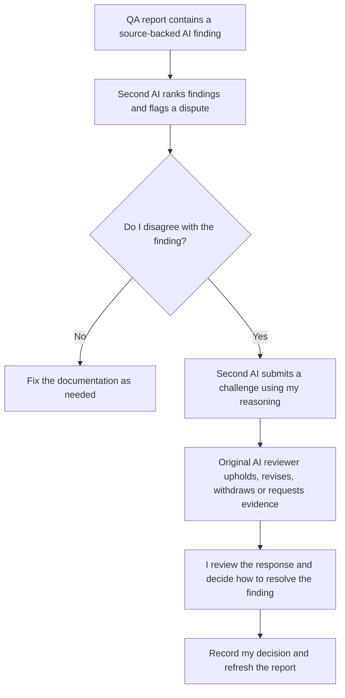

import CaseStudySummary from '@site/src/components/CaseStudySummary';
import DiagramFigure from '@site/src/components/DiagramFigure';

<CaseStudySummary {...{
  "employer": "Independent project",
  "industry": "Documentation engineering",
  "projectType": "Documentation QA",
  "summary": "I built a QA pipeline for this portfolio that checks documentation before publication and gives reviewers the evidence behind each AI finding.",
  "role": "Designed and implemented the review pipeline and CI policy",
  "scope": "Local reviews, pull request checks and report publication",
  "decision": "Require source evidence for AI findings and link human decisions to the reviewed revision",
  "deliverables": "Python CLI, checker adapters, review reports and GitHub Actions workflows",
  "evidenceTitle": "What reviewers can inspect",
  "evidence": [
    {"value": "Source evidence", "label": "Compare an AI criticism with the passages it cites"},
    {"value": "Decision history", "label": "See earlier decisions and whether they need revalidation"},
    {"value": "Commit-specific reports", "label": "Inspect what the workflow checked and why the gate failed"}
  ]
}} />

## Context {/* #context */}

A link checker can tell whether a local link resolves. That is a true-or-false condition with no room for doubt. It takes a different kind of review to spot two guides giving incompatible instructions for the same task. This is where AI shines. I built a shared review pipeline for this Docusaurus portfolio to run both kinds of checks locally and in GitHub Actions, then inspect their results in one report.

## Challenge {/* #challenge */}

Generate a documentation quality report that distinguishes a clean check from a failed checker. It must also give a reviewer enough context to decide whether an AI criticism is valid. A quotation can be accurate while the conclusion drawn from it is wrong. The surrounding text might resolve the apparent ambiguity, or the suggested rewrite might introduce a fact the source never established.

Dismissing an incorrect AI finding resolves that finding in the report. On a fresh review, the model can raise the same criticism with different wording, quote another line, or propose a different fix. For example, it might first say a guide omits a prerequisite, then say the reader is never told what to set up. Both findings may overlook the same existing setup step. Matching the exact wording would miss the connection and send the reviewer back over the same ground.

## Approach {/* #approach */}

I used *deterministic checks* for local and external links, accessibility, Markdown and MDX linting, prose style and terminology, and spelling and grammar. These checks apply fixed rules and return the same findings given the same inputs. For example, the external link checker uses the HTTP response it receives to decide whether a link passes. [Available checks and presets](../implementation-details/qa-cli-reference.md#review-scope-and-check-presets)

AI review handles questions that depend on meaning, including contradictions between pages. For cross-page review, the model receives the selected documents with file paths and line numbers so it can cite both passages and identify the page to fix.

To help with this problem, I require the AI reviewer to explain the impact of each issue it finds and quote the text it relies on. The pipeline checks the quotations against the supplied source, then sends valid proposals through a separate verification request. For a substantive defect, the verifier considers the strongest reasonable reading and checks whether the problem still holds. That extra request adds latency and API usage. This is where caching comes in.

### Caching

When a document and the review settings are unchanged, the cache key (see diagram below) stays the same. If the key matches a completed review, the pipeline skips both LLM requests and reuses the same AI findings, making repeat reviews faster and more consistent. It applies the latest human feedback each time, so a dismissal can take effect immediately and the model has no chance to rephrase the criticism on that run. When an edit or a change to the review settings changes the key, the pipeline runs a fresh review. The same criticism can then return under a new finding, and its dismissal may need reconsidering if the edit changed the meaning. [AI review and caching](../implementation-details/qa-ai-review.mdx)

## Implementation {/* #implementation */}

The Python CLI selects the documents and checks for each run. Adapters translate tool output into shared findings and record checker errors separately. One report model produces HTML for human inspection and JSON and Markdown for AI review. The CLI can also regenerate the report from the findings and checker errors saved in JSON. It applies the latest reviewer decisions and recalculates the counts used to decide whether the CI gate passes. For example, if a reviewer dismisses a finding that counted towards the gate, the refreshed report shows the dismissal and excludes that finding from the gate count without rerunning any checks. [Pipeline and report flows](../implementation-details/qa-architecture.mdx)

I tied feedback to the document revision and proposed fix. To catch reworded criticisms, the pipeline shortlists earlier findings using quotation overlap and semantic similarity, then asks the model to compare the claims. The report can surface the earlier discussion and its reasoning alongside a likely recurrence. A reviewer confirms whether the findings raise the same issue and whether the previous decision still applies. If the source changed, the report asks for revalidation before carrying the dismissal forward. [Finding matching and revalidation](../implementation-details/qa-feedback.md)

### Adjudication process

<DiagramFigure {...{
  "title": "Adjudicating a disputed AI finding",
  "shareId": "adjudicating-a-disputed-ai-finding",
  "legend": [
    {"role": "input", "label": "QA findings"},
    {"role": "generation", "label": "AI triage and reassessment"},
    {"role": "interaction", "label": "Human judgment and actions"}
  ]
}}>

</DiagramFigure>

The CLI records the challenge and its reasoning, the AI reviewer’s response, and any separately recorded human decision in `qa/feedback.json`. When I commit that file, Git preserves an audit trail showing why I challenged a finding and whether I overruled the AI reviewer. [Feedback and decision history](../implementation-details/qa-feedback.md)

### CI eligibility and CI gates

I put the CI eligibility rules in Python. An AI finding counts towards the gate when it is a high-confidence defect with no human dismissal, and its severity is capped at medium. Checker errors have a separate threshold. The deployment workflow verifies that the report belongs to the current run and publishes it with the site before surfacing a failed QA gate. [Report publication and CI policy](../implementation-details/qa-reports-and-ci.mdx)

## Impact {/* #impact */}

A contributor can run a review before opening a pull request. On deployment, the portfolio publishes a report tied to the commit it checked. The report lets me inspect the quoted evidence, see prior decisions and tell whether the gate failed because of findings or a checker error. When a human decision changes, I can refresh the report without paying for another AI review.

The pipeline has improved the quality of my documentation by helping me spot and correct errors quickly. I feed the findings to a second AI, which groups them by issue type, ranks them by priority and brings a few high-priority disputes to me. That lets me act on clear fixes quickly and spend my review time deciding whether the disputed findings are valid and what to change. When I disagree with a finding, I can ask the second AI to use my reasoning to challenge it with the original AI reviewer.

The [latest QA report](pathname:///qa/) shows the output on this site. When the report has few active findings, it offers a separate example with synthetic findings and a simulated checker failure. The [Documentation QA guide](../implementation-details/qa-overview.md) covers how to run a review and act on the results.
