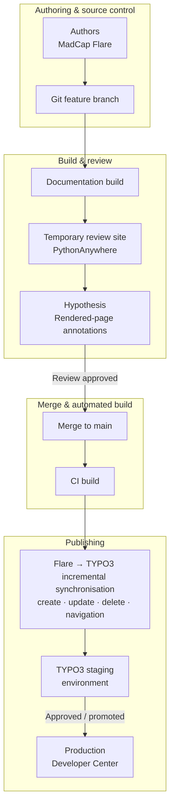

---
organisations:
  - paysafe
title: Building the Paysafe Developer Center
description: Case study of leading the documentation work for the launch of the Paysafe Developer
  Center
slug: /case-studies/paysafedevcenter
sidebar_position: 3
sidebar_custom_props:
  caseStudyCard:
    title: Paysafe Developer Center
    tag: Developer portal
    description: Led documentation strategy and delivery for Paysafe’s public developer portal.
    highlights:
      - Consolidated hundreds of pages across payment APIs, SDKs and integration guides
      - Led and trained three technical writers while remaining a hands-on API writer
    ariaLabel: Read the Paysafe Developer Center case study
type:
  - case-study
audiences:
  - developers
  - documentation-managers
  - technical-writers
topics:
  - api-documentation
  - information-architecture
  - docs-as-code
  - documentation-engineering
  - developer-experience
technologies:
  - git
  - api-blueprint
  - hypothesis
  - typo3
  - rest
lifecycle:
  - historical
tags:
  - api-blueprint
  - api-documentation
  - developer-experience
  - docs-as-code
  - documentation-engineering
  - git
  - hypothesis
  - information-architecture
  - paysafe
  - rest
  - typo3
---

import DiagramFigure from '@site/src/components/DiagramFigure';

import SemanticLabel, {SemanticLabelGroup} from '@site/src/components/SemanticLabel';

import CaseStudySummary from '@site/src/components/CaseStudySummary';

<CaseStudySummary {...{
  "employer": "Paysafe",
  "industry": "Payments / Fintech",
  "projectType": "Public developer portal",
  "icon": "code",
  "summary": "Led documentation strategy and delivery for Paysafe’s unified Developer Center, a key technology initiative during a period of fast growth*. The portal brought together API, SDK and integration documentation from Optimal Payments and Skrill.",
  "summaryUnderline": "fast growth",
  "summaryNoteHref": "#context",
  "role": "Documentation strategy, information architecture and team leadership",
  "scope": "Optimal Payments and Skrill developer documentation",
  "decision": "Flare and Git authoring with custom incremental publishing to the corporate CMS (TYPO3)",
  "deliverables": "Unified public developer portal, content migration, API Blueprint references, automated publishing and SME review workflow",
  "evidenceTitle": "Delivery evidence and business context",
  "evidence": [
    {
      "value": "Hundreds of pages migrated",
      "label": "API, SDK and integration documentation from Optimal Payments and Skrill"
    },
    {
      "value": "3",
      "label": "Technical writers led and trained",
      "emphasis": "metric"
    },
    {
      "value": "$1bn+",
      "label": "Paysafe FY2016 revenue",
      "emphasis": "metric"
    },
    {
      "value": "63%*",
      "label": "FY2016 reported revenue growth",
      "emphasis": "metric",
      "labelStyle": "note"
    }
  ]
}} />

## Context {/* #context */}

After Optimal Payments acquired Skrill Group in August 2015 and rebranded as Paysafe, I led the documentation work on a ten-month project to build a new unified Developer Center. The site brought together API and SDK reference documentation, integration guides, and product information for merchants integrating Paysafe's payment methods, replacing documentation previously distributed across the two businesses.

Paysafe was growing rapidly while integrating Skrill. In 2016, reported revenue rose 63% year on year to just over US$1 billion. As the group consolidated its payments products, merchants needed a single place to learn how to integrate them. Paysafe’s CEO highlighted the Developer Center’s December launch in the group’s Strategic Report as part of its technology strategy to simplify merchant onboarding. [Paysafe Annual Report 2016, pp. 21 and 23](https://data.fca.org.uk/artefacts/NSM/data-migration/130622071.pdf)

I defined the documentation strategy and information architecture, specified the authoring and publishing platform, planned the legacy-content migration, and worked with Paysafe's web development team and an external consultancy on the implementation. I led a team of three technical writers while remaining hands-on, authoring new API and integration documentation.

See the current version of the [Paysafe Developer Center](https://developer.paysafe.com) for reference.

## Challenge {/* #challenge */}

The project involved:

- consolidating and migrating hundreds of pages from the Optimal Payments Developer Center and Skrill's PDF-based documentation

- defining a scalable information architecture and consistent content structures for multiple payment APIs, SDKs, integration methods, product documentation, and reference material

- creating a Git-based workflow with repeatable build, review, and publishing processes

- building the team's technical capability to operate and maintain the new documentation platform

The documentation team needed a structured authoring and source-control workflow, while the public Developer Center had to operate within Paysafe's existing TYPO3-based web platform. The publishing process therefore needed to connect two very different content models without recreating the documentation manually in the CMS.

## Approach {/* #approach */}

I reviewed developer portals from PayPal, Braintree, and Stripe to identify effective patterns in developer experience, navigation, API reference documentation, and integration guidance, and used the findings to define requirements for both the Developer Center and its documentation toolchain.

From this research, I designed an information architecture based on product landing pages, hierarchical navigation, and consistent structures for getting-started content, integration guides, and API and SDK reference documentation.

### Authoring platform {/* #authoring-platform */}

<SemanticLabelGroup>

<SemanticLabel type="decision" appearance="row">
  Implement MadCap Flare with Git version control as the documentation authoring platform.
</SemanticLabel>

<SemanticLabel type="rationale" appearance="row">
  Combine reusable, conditional content and Git version control with an authoring environment the team could learn comfortably.
</SemanticLabel>

</SemanticLabelGroup>

Flare's XHTML source and Git integration supported an eventual move towards docs-as-code. At the time, Markdown-based workflows did not support content reuse and conditional text as well. Working in a technical authoring tool also presented a smaller learning curve for the team than editing Markdown directly.

### Publishing architecture {/* #publishing-architecture */}

Having chosen Flare and Git for authoring, I specified the technical requirements for publishing Flare output to TYPO3, Paysafe’s existing web content management system. I agreed the design with Paysafe’s web development team and an external consultancy, who implemented the integration together. I then tested the integration and recommended improvements.

<SemanticLabelGroup>

<SemanticLabel type="decision" appearance="row">
  Publish Flare output into TYPO3 through a custom incremental synchronization tool.
</SemanticLabel>

<SemanticLabel type="trade-off" appearance="row">
  The publishing workflow depended on custom integration code to keep the documentation source and CMS content aligned.
</SemanticLabel>

</SemanticLabelGroup>

Documentation changes were developed in Git feature branches and built for review before being merged to the main branch. A merge triggered an automated build and publication to a TYPO3 staging environment through the custom integration, where the documentation underwent final inspection before promotion to production.

The TYPO3 integration created records for new content, updated changed records, removed deleted content, and synchronised changes to the Flare table of contents with the site's navigation. Because synchronisation applied only the required deltas, unchanged CMS records were not recreated and users' cached browser pages were not unnecessarily invalidated.

For urgent production fixes, changes could be made directly in TYPO3 and subsequently backported into Flare/Git, ensuring that the authoritative source was brought back into sync with production.

### Developer Center authoring and publishing workflow {/* #developer-center-authoring-and-publishing-workflow */}

The diagram below summarises the authoring, review and publishing sequence.

<DiagramFigure {...{
  "title": "Developer Center authoring and publishing",
  "shareId": "developer-center-authoring-and-publishing",
  "subgraphNotes": {
    "AUTHORING": "The team used MadCap Flare for reusable and conditional content. Git feature branches kept each change separate until it was ready to merge.",
    "REVIEW": "A temporary site let reviewers see the published layout before launch. With Hypothesis, they could attach feedback directly to the relevant passage.",
    "CI": "Merging an approved change to main triggered the CI build, which prepared the documentation for synchronisation into TYPO3 staging.",
    "PUBLISH": "The integration added, updated or removed only the TYPO3 records that had changed and kept navigation in sync. Staging gave the team a final check before promotion to production."
  },
  "legend": [
    {
      "role": "interaction",
      "label": "Authoring, review and published interfaces"
    },
    {
      "role": "input",
      "label": "Version-controlled source"
    },
    {
      "role": "process",
      "label": "Build, merge and synchronisation"
    },
    {
      "role": "infra",
      "label": "Staging environment"
    }
  ]
}}>

</DiagramFigure>

## Implementation {/* #implementation */}

I built post-build automation that published rendered Flare output to temporary PythonAnywhere review environments and integrated the open-source Hypothesis annotation tool. This allowed reviewers to comment directly on the rendered pages, rather than reviewing source files in isolation, before changes were merged and promoted through the publishing workflow.

I also built the production site's page-level feedback mechanism in JavaScript, with responses passed through a server-side component into JIRA for tracking and follow-up.

I developed migration tooling to transform and move hundreds of pages from the Confluence-based Optimal Payments Developer Center into the new platform.

My team and I migrated API reference material to API Blueprint, a machine-readable API description format similar in purpose to OpenAPI. The Developer Center used these structured definitions to generate parameter tables, code samples, and `curl` examples automatically, reducing manually duplicated content and improving consistency across the rendered API reference.

To make the new workflow sustainable beyond the initial implementation, I trained the three writers in MadCap Flare, Git, REST APIs, CSS, JavaScript, and the architecture of the Developer Center's build and publishing system. During adoption, I supported the team with source-control issues and merge conflicts and reviewed documentation changes for technical accuracy and clarity. This combined hands-on support with training and development so that the team could increasingly operate and maintain the documentation platform independently.

## Impact {/* #impact */}

The first phase launched in December 2016, bringing Optimal Payments and Skrill integration documentation into one public portal. The new workflow let subject-matter experts annotate rendered pages before release and gave the documentation team a repeatable way to publish content and navigation updates to TYPO3 staging.

Paysafe identified the Developer Center as a key achievement supporting its 2016 technology strategy. In its [Annual Report](https://data.fca.org.uk/artefacts/NSM/data-migration/130622071.pdf), the Chief Operating Officer described the portal as enabling merchants and developers to integrate Paysafe products through open APIs and SDKs (p. 29). The Payment Processing review also identified the Developer Center as the foundation for engaging the developer community, supporting integration, and gathering feedback to inform Paysafe's product roadmap (p. 32).

## Lessons learned {/* #lessons-learned */}

- Today, I would favour extended Markdown with automated quality checks, provided the toolchain met the project's content-reuse and conditional-publishing requirements. This would make direct contributions easier for engineers and support staff.

- For large-scale HTML migration, I would now use DOM-aware parsing and transformation, for example with Python and Beautiful Soup, rather than relying primarily on regular-expression transformations. The regexp-based approach worked, but required more manual clean-up.
