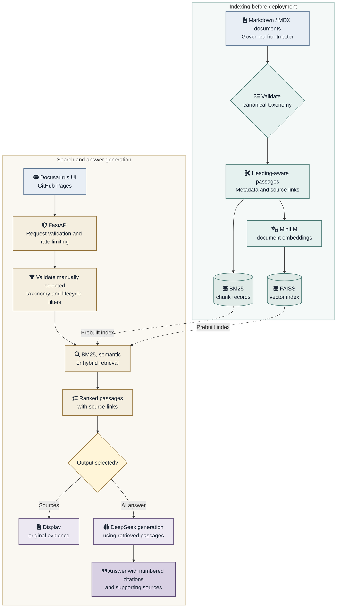
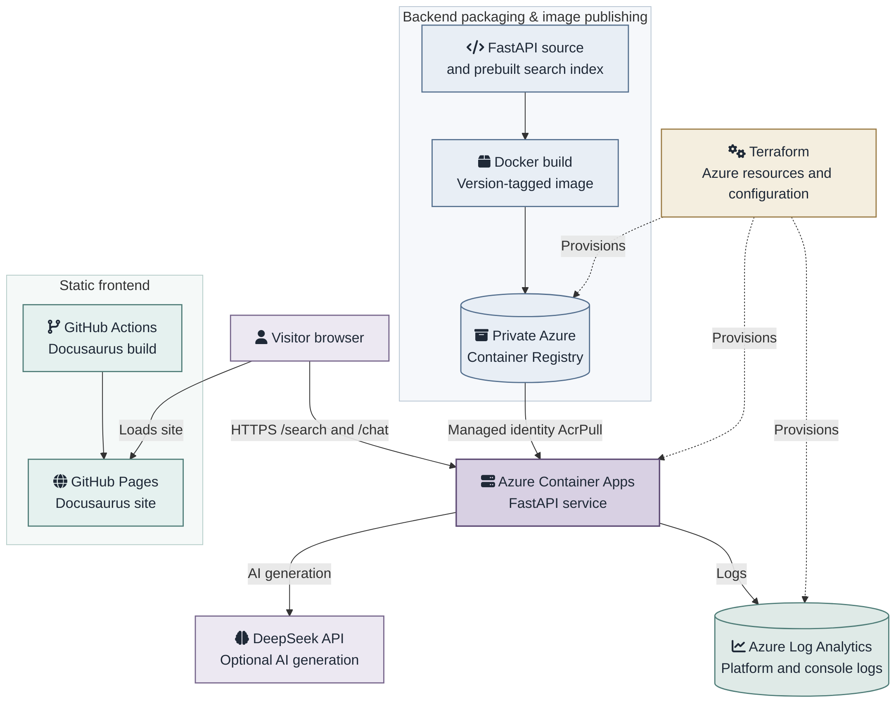

## Project overview

I designed and deployed a **cloud-based retrieval-augmented generation (RAG)** application to test how documentation governance can improve the way people find technical information. Visitors can search my portfolio using keywords, semantic similarity or hybrid retrieval, then inspect the original passages or request an AI-generated answer grounded in those passages.

The idea grew out of my experience integrating RAG search into a large docs-as-code developer portal I managed at an investment bank. I saw an opportunity to use document metadata, such as whether an API was current or deprecated, to control which content was retrieved. This could, for example, reduce the risk of developers inadvertently integrating with deprecated APIs.

[Try the portfolio search](https://iand4096.github.io/docusaurusportfolio/ai-search).

## The challenge

Conventional keyword search works well when readers know the terminology, but it can miss relevant material described in different words. Semantic search can find related passages even when they use different terminology, yet similarity alone does not establish whether a document belongs to the right topic, audience or lifecycle state.

I wanted to test whether document metadata could control which passages a RAG system retrieved. The application also needed to preserve links to the source documentation and support conventional search without relying on an LLM.

The application also needed a cloud deployment with controlled running costs that kept provider credentials out of the frontend and put limits on paid AI requests.

## My approach

### Treat metadata as part of the retrieval architecture

I used the portfolio's Markdown and MDX documents as the knowledge source. The ingestion pipeline validates their taxonomy before indexing, extracts frontmatter and headings, and creates heading-aware, paragraph-aligned passages of up to 1,500 characters. Each indexed passage retains its title, source location and governed facets: **content type, audience, topic, technology and lifecycle**.

The API validates the selected facets against the canonical taxonomy and uses them to filter retrieval results. Filters can be combined across dimensions, and archived content is excluded unless the visitor explicitly includes it.

### Combine lexical and semantic retrieval

I implemented three search modes with different strengths:

- **Keyword search:** BM25 ranks matches for exact terms, API names and technical identifiers.
- **Semantic search:** `sentence-transformers/all-MiniLM-L6-v2` generates embeddings, searched through a FAISS vector index to find related concepts expressed in different words.
- **Hybrid search:** Reciprocal Rank Fusion (RRF) combines BM25 and semantic rankings without assuming their raw scores are directly comparable.

The index is generated ahead of deployment and packaged with the backend. A cached index snapshot supports subsequent requests without reloading the retrieval model each time. The public interface defaults to hybrid search and displays ranked evidence with links back to its source documentation.

### Separate evidence retrieval from AI answer generation

I exposed a Python **FastAPI** service with `/taxonomy`, `/search` and `/chat` endpoints. Requests are validated with Pydantic before search filters are checked against the governed taxonomy.

`/search` returns relevant source passages without calling an LLM. `/chat` uses retrieved passages as context for **DeepSeek**, asking it to answer from the supplied evidence, cite numbered sources and acknowledge gaps. The interface displays the supporting sources and warns visitors to verify AI-generated answers against the original material. Prompt instructions reduce risk but do not guarantee factual correctness.

This ensures visitors can search and inspect source passages without using DeepSeek.

### Architecture

The diagram shows the implemented indexing and query paths. **Taxonomy selection is manual at query time**, not an automatic query-classification stage.

### Cloud architecture: docker, terraform and azure

I separated the static frontend from the Python service. **Docusaurus is built by GitHub Actions and published to GitHub Pages**; visitors’ browsers send HTTPS requests directly to **FastAPI on Azure Container Apps**. The portfolio remains a static site; retrieval and AI generation run in the Azure-hosted API. CORS explicitly permits the GitHub Pages origin.

**Docker** packages the FastAPI application, its Python dependencies, the embedding model and the prebuilt search-index artifacts. A PowerShell build script then publishes version-tagged images to a private **Azure Container Registry (ACR)**. Index generation happens before deployment, not when each container starts. Docker Compose provides a separate local development path.

I use **Terraform with the AzureRM provider** to provision the Azure resource group, ACR, Container Apps environment and application, **Log Analytics** workspace, and a **user-assigned managed identity**. The identity receives scoped `AcrPull` permission; this allows the Container App to retrieve the private image without an ACR administrator password. After publishing an image, I update its tag in Terraform, review `terraform plan` and run `terraform apply` to deploy a new Container Apps revision.

The Container App uses the **Consumption** workload profile with **one vCPU, 2 GB memory and zero-to-one replicas**. Scale-to-zero limits idle compute costs, at the expense of first-request latency. Azure Container Apps holds the DeepSeek API key as a secret and injects it into FastAPI through an environment-variable reference; the key is not embedded in the browser application or managed as a Terraform secret value.

For a publicly accessible service, I added per-client rate limits, input bounds, concurrency controls and a feature flag for paid generation. These controls reduce abuse but are **not equivalent to authentication, document-level authorisation or a durable spending quota**. The existing Log Analytics integration provides platform and console logs; distributed tracing and application performance dashboards are future work.

## Deliverables

- A [public governed RAG search interface](https://iand4096.github.io/docusaurusportfolio/ai-search) with keyword, semantic and hybrid retrieval, manually selected taxonomy filters, source links and an AI-answer option.
- A documentation ingestion and indexing pipeline that produces passage metadata, FAISS vectors and a source manifest after taxonomy validation.
- A FastAPI retrieval and generation API, with validation and controls for public requests.
- Versioned Docker image builds and Terraform-managed Azure infrastructure, including private registry access through managed identity and operational logs.
- Rate-limiter unit tests and deployment checks covering API behaviour, revision state, logs and browser access.

## Outcome

The portfolio now exposes a working, source-linked RAG search interface through GitHub Pages, backed by a separately deployed, containerised Azure API. Direct search tests returned indexed passages, and the abuse-protection tests passed for rate-limit expiry, independent endpoint limits and forwarded-header handling.

Two deployment issues provided useful operational evidence. A GitHub Pages request initially failed its CORS preflight because the API allowed only localhost origins; after I added the published site's origin, the same `OPTIONS /search` check returned **HTTP 200** with the expected CORS header. Azure system logs also showed an image pull taking **62.22 seconds** after scale-to-zero, identifying a significant part of first-request latency before the application started.

The application is deployed and its core retrieval and generation workflows have been tested. However, I have not yet measured retrieval relevance, search time or answer accuracy against a representative evaluation set.

## What I would change

- **Infer taxonomy filters from search queries.** This is the part of the original idea I have not yet implemented. I want to test whether a user's question can be mapped reliably to the approved taxonomy, with suggested filters shown for confirmation or adjustment. I would evaluate both retrieval relevance and the risk of incorrectly excluding relevant documents.

- **Introduce RAG evaluation.** Build a labelled set of representative questions and expected source passages; measure retrieval using metrics such as Recall@k and MRR, and review AI answers for groundedness and citation accuracy. I could then compare chunking strategies, embedding models and retrieval parameters against the same questions.

- **Add application observability.** Instrument the FastAPI request lifecycle and RAG stages—model initialisation, query embedding, BM25, FAISS, ranking and DeepSeek generation—with **OpenTelemetry** traces and metrics. Export telemetry to **Azure Application Insights / Azure Monitor** alongside the existing Log Analytics logs, using sampling and avoiding sensitive queries, evidence text and credentials. Track request latency, errors, rate-limit responses and external dependency time; evaluate **Grafana** later if a dedicated dashboard adds value. This is planned instrumentation, not a currently deployed monitoring stack.

- **Improve cold-start performance and operational safeguards.** Separate lightweight liveness checks from retrieval readiness and reduce the CPU-serving image size. If public usage grows, replace the in-memory abuse counters with a durable quota mechanism and add more explicit provider-usage monitoring.
