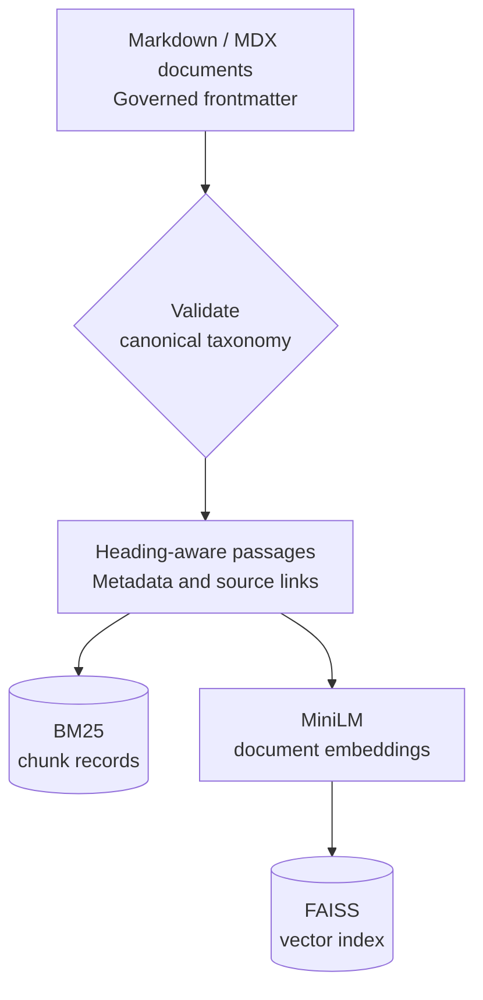
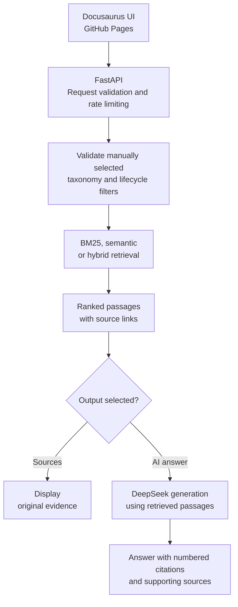
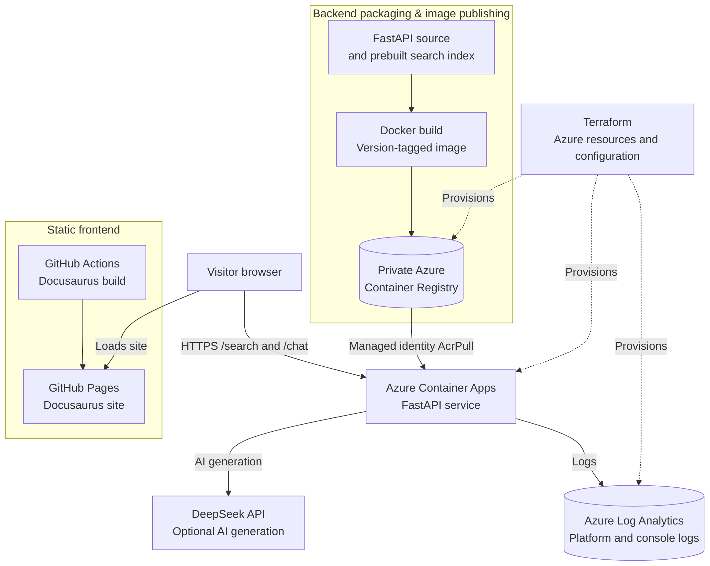

import ApiEndpoint from '@site/src/components/ApiEndpoint';
import ApiExample from '@site/src/components/ApiExample';
import DiagramFigure from '@site/src/components/DiagramFigure';

import CaseStudySummary from '@site/src/components/CaseStudySummary';

<CaseStudySummary {...{
  "employer": "Independent project",
  "industry": "AI / Developer tooling",
  "projectType": "Cloud search application",
  "icon": "magnifying-glass",
  "summary": "Built and deployed portfolio search with governed retrieval and source-linked AI answers.",
  "role": "Sole architect, developer and deployment engineer",
  "scope": "Search and AI-assisted retrieval for my portfolio documentation",
  "decision": "Hybrid BM25/FAISS retrieval with metadata filters, separate from AI generation",
  "deliverables": "FastAPI service, ingestion pipeline, React interface and Terraform-managed Azure deployment",
  "evidenceTitle": "Delivered Capabilities",
  "evidence": [
    {
      "value": "3",
      "label": "Retrieval modes",
      "emphasis": "metric"
    },
    {
      "value": "Governed filters",
      "label": "Taxonomy and lifecycle constraints"
    },
    {
      "value": "Azure API",
      "label": "Containerised, source-linked search"
    }
  ]
}} />

## Project context {/* #project-overview */}

I designed and deployed a **cloud-based retrieval-augmented generation (RAG)** application to test how documentation governance can improve the way people find technical information. Visitors can search my portfolio using keywords, semantic similarity or hybrid retrieval, then inspect the original passages or request an AI-generated answer grounded in those passages.

The idea grew out of my experience integrating RAG search into a large docs-as-code developer portal at an investment bank. I saw an opportunity to use document metadata, such as whether an API was current or deprecated, to control which content was retrieved. This could, for example, reduce the risk of developers inadvertently integrating with deprecated APIs.

[Try the portfolio search](https://iand4096.github.io/docusaurusportfolio/ai-search).

## The challenge

Conventional keyword search works well when readers know the terminology, but it can miss relevant material described in different words. Semantic search can find related passages even when they use different terminology. However, similarity alone does not establish whether a document belongs to the right topic, audience or lifecycle state.

I wanted to test whether document metadata could control which passages a RAG system retrieved. The application also needed to preserve links to the source documentation and support conventional search without relying on an LLM.

Finally, the cloud deployment needed to control running costs, keep provider credentials out of the frontend and limit paid AI requests.

## My approach

I used Codex as an agentic coding assistant while building the search API and portfolio search interface.

### Filter search results by document metadata {/* #treat-metadata-as-part-of-the-retrieval-architecture */}

The ingestion pipeline checks the portfolio's Markdown and MDX metadata against the taxonomy before indexing. It uses headings and paragraph breaks to divide the text into passages of up to 1,500 characters. Each passage keeps its title, source location and the values readers can filter by: **content type, audience, topic, technology and lifecycle**.

Readers choose the filters. They can combine a topic and an audience to find API documentation for developers. The API validates the selections against the taxonomy and returns passages that match. It excludes archived content unless readers choose to include it.

### Combine lexical and semantic retrieval

I implemented three search modes with different strengths:

- **Keyword search:** BM25 ranks matches for exact terms, API names and technical identifiers.
- **Semantic search:** `sentence-transformers/all-MiniLM-L6-v2` generates embeddings, searched through a FAISS vector index to find related concepts expressed in different words.
- **Hybrid search:** Reciprocal Rank Fusion (RRF) combines BM25 and semantic rankings without assuming their raw scores are directly comparable.

I build the index before deployment and package it with the API. Each API process caches the loaded index and embedding model and reuses them for subsequent requests. The search interface defaults to hybrid search and links each ranked passage to its source.

### Separate evidence retrieval from AI answer generation

I exposed three endpoints through a Python **FastAPI** service. Requests are validated with Pydantic before search filters are checked against the governed taxonomy.

- The taxonomy endpoint (<ApiEndpoint operationId="taxonomy" />) lists filter dimensions and their active terms.
- The search endpoint (<ApiEndpoint operationId="search" />) returns passages with source links without calling an LLM.
- For AI-generated answers, the chat endpoint (<ApiEndpoint operationId="chat" />) supplies retrieved passages to **DeepSeek**. It asks DeepSeek to answer from the supplied evidence, cite numbered sources and acknowledge gaps. The interface displays the supporting sources and warns visitors to verify AI-generated answers against the original material. Prompt instructions reduce risk but do not guarantee factual correctness.

The request below uses `taxonomy`, one of the topic terms listed by `/taxonomy`, to filter a keyword search. The response shows the top-ranked passage and a link to its source section.

<ApiExample operationId="search" example="taxonomy-filter" />

### Indexing and query flow {/* #architecture */}

The diagrams show how the pipeline builds the index and how the API uses it to answer a query.

<DiagramFigure {...{
  "title": "Documentation indexing and search",
  "shareId": "documentation-indexing-and-search",
  "nodeNotes": {
    "indexing-before-deployment": {
      "Docs": "The index starts with the portfolio’s Markdown and MDX files. Their front matter supplies fields such as audience, topic and lifecycle.",
      "Validate": "The build checks document metadata against the taxonomy before indexing. An invalid term or missing required field can stop the build.",
      "Chunk": "The indexer splits text at heading and paragraph boundaries. Each passage keeps its document metadata and a link to its source.",
      "Records": "The build saves passage text, titles and headings in chunk records. The API uses those fields to rank keyword matches with BM25.",
      "Embed": "MiniLM turns each passage, including its title and heading, into a vector for semantic comparison.",
      "Vector": "FAISS stores the passage vectors in the same order as the chunk records. A vector match can therefore be traced back to the text and source link."
    },
    "search-and-answer-generation": {
      "UI": "The reader enters a query and can choose the search mode, filters and whether to ask for an AI answer.",
      "API": "FastAPI validates the query and requested result count. Rate limits and capacity limits control how much work the public API accepts.",
      "Facets": "The API checks filter values against the taxonomy and uses them to determine which passages are eligible. It excludes archived content by default.",
      "Retrieve": "BM25 ranks term matches. Semantic search compares the query vector with passage vectors. Hybrid search combines the two rankings.",
      "Rank": "The API returns up to the requested number of eligible passages. Each result includes its text and a link to the original page or section.",
      "Choice": "The reader chooses whether to view source passages or ask the API to generate an answer using retrieved evidence.",
      "Sources": "The search endpoint returns the matching passages and their links without calling DeepSeek.",
      "LLM": "The chat endpoint retrieves passages and sends them to DeepSeek with instructions to cite the numbered sources and acknowledge gaps.",
      "Answer": "The interface shows the generated answer with its supporting sources so the reader can check the claims against the original documentation."
    }
  },
  "legend": [
    {
      "role": "input",
      "label": "Inputs and build preparation"
    },
    {
      "role": "process",
      "label": "Processing and delivery"
    },
    {
      "role": "storage",
      "label": "Stored data and telemetry"
    },
    {
      "role": "decision",
      "label": "Decisions"
    },
    {
      "role": "interaction",
      "label": "User interaction and results"
    },
    {
      "role": "generation",
      "label": "AI generation"
    }
  ]
}}>

#### Indexing before deployment

#### Search and answer generation

</DiagramFigure>

The retrieval step uses the prebuilt BM25 chunk records and FAISS vector index produced by the indexing flow.

### Deployment on Azure {/* #cloud-architecture-docker-terraform-and-azure */}

I separated the static frontend from the Python service. **GitHub Actions builds the Docusaurus site and publishes it to GitHub Pages**. Visitors’ browsers send HTTPS requests directly to **FastAPI on Azure Container Apps**. The portfolio remains a static site; retrieval and AI generation run in the Azure-hosted API. CORS explicitly permits the GitHub Pages origin.

**Docker** packages the FastAPI application, its Python dependencies, the embedding model and the prebuilt search-index artifacts. A PowerShell build script then publishes version-tagged images to a private **Azure Container Registry (ACR)**. Index generation happens before deployment, not when each container starts. Docker Compose provides a separate local development path.

I use **Terraform with the AzureRM provider** to provision the Azure resource group, ACR, Container Apps environment and application, **Log Analytics** workspace, and a **user-assigned managed identity**. I grant the managed identity the `AcrPull` role on the registry. The Container App uses that identity to pull the private image without an ACR administrator password. Once an image is published, I update its tag in Terraform, review `terraform plan` and run `terraform apply` to deploy a new Container Apps revision.

<DiagramFigure {...{
  "title": "Azure deployment architecture",
  "shareId": "azure-deployment-architecture",
  "subgraphNotes": {
    "PACKAGE": "The versioned Docker image bundles FastAPI with a prebuilt search index. Azure Container Apps pulls it from the private registry using managed identity.",
    "FRONTEND": "GitHub Actions builds the static Docusaurus site for GitHub Pages. The visitor’s browser calls the Azure API directly for search and optional AI answers."
  },
  "nodeNotes": {
    "Terraform": "Provisions the registry, Container App and Log Analytics workspace. It also assigns the managed identity the registry-scoped AcrPull role.",
    "Browser": "Loads the static site from GitHub Pages, then calls the Azure API directly to search passages or request a cited answer.",
    "ACA": "Pulls the private image with its managed identity and runs FastAPI with the bundled search index. It scales to zero when idle.",
    "DeepSeek": "Receives retrieved passages only when a reader chooses an AI answer and generation is enabled. FastAPI calls it using a server-side key.",
    "Logs": "Collects platform and container console logs. These logs helped measure how long the image pull took during a cold start."
  },
  "legend": [
    {
      "role": "input",
      "label": "Source code and prebuilt index"
    },
    {
      "role": "process",
      "label": "Processing and delivery"
    },
    {
      "role": "storage",
      "label": "Stored data and telemetry"
    },
    {
      "role": "infra",
      "label": "Infrastructure configuration"
    },
    {
      "role": "interaction",
      "label": "User-facing site and browser"
    },
    {
      "role": "generation",
      "label": "AI generation"
    }
  ]
}}>

</DiagramFigure>

#### Cost and abuse controls

The Container App uses the **Consumption** workload profile with **one vCPU, 2 GB memory and zero-to-one replicas**. I use scale-to-zero to limit idle compute costs. The first request after an idle period takes longer because the app has to start a replica. I store the DeepSeek API key as an Azure Container Apps secret and set its value outside Terraform. FastAPI reads the key from an environment variable that references the secret. The key stays on the server.

As this is a publicly accessible server, I added per-client rate limits, input bounds, concurrency controls and a feature flag for paid generation. These controls reduce abuse but are **not equivalent to authentication, document-level authorisation or a durable spending quota**. The existing Log Analytics integration provides platform and console logs; distributed tracing and application performance dashboards are future work.

## Deliverables

- [Try the live portfolio search](https://iand4096.github.io/docusaurusportfolio/ai-search) to compare search modes, apply filters or request an AI answer.
- [Explore the Search API reference](pathname:///search-api) for endpoint definitions and example calls.

## Outcome

I verified that search returned indexed passages with source links and tested the AI answer workflow. Tests also passed for rate-limit expiry, independent endpoint limits and forwarded-header handling. I haven’t measured retrieval relevance, response time or answer accuracy against a representative set of questions.

The browser’s CORS preflight failed because the API allowed only localhost origins. After I added the GitHub Pages origin, the same `OPTIONS /search` request returned **HTTP 200** with the expected CORS header.

Azure logged a **62.22-second** image pull after scale-to-zero. That pull accounted for part of the first request’s delay.

## What I would change

- **Can the search suggest useful filters?** I’d map questions to taxonomy terms and let readers confirm or adjust the suggestions. I’d measure whether the filters improve relevance and how often they hide useful documents.

- **Which retrieval settings work best?** I’d build a labelled set of questions and expected source passages. I’d compare chunk sizes, embedding models and search settings using recall at a fixed result count and mean reciprocal rank, then check whether the AI answers use and cite the right passages.

- **Where does the API spend its time?** I’d use **OpenTelemetry** to trace model startup, retrieval and DeepSeek generation, then export sampled telemetry to **Azure Application Insights / Azure Monitor**. The telemetry would track latency, errors and rate-limit responses while excluding query text, evidence and credentials. If the existing dashboards leave a gap, I’d consider **Grafana**.

- **Can I shorten cold starts and keep spending predictable?** I’d reduce the CPU image size and separate the lightweight liveness check from retrieval readiness. If public usage grows, I’d add a durable quota and monitor provider usage.
