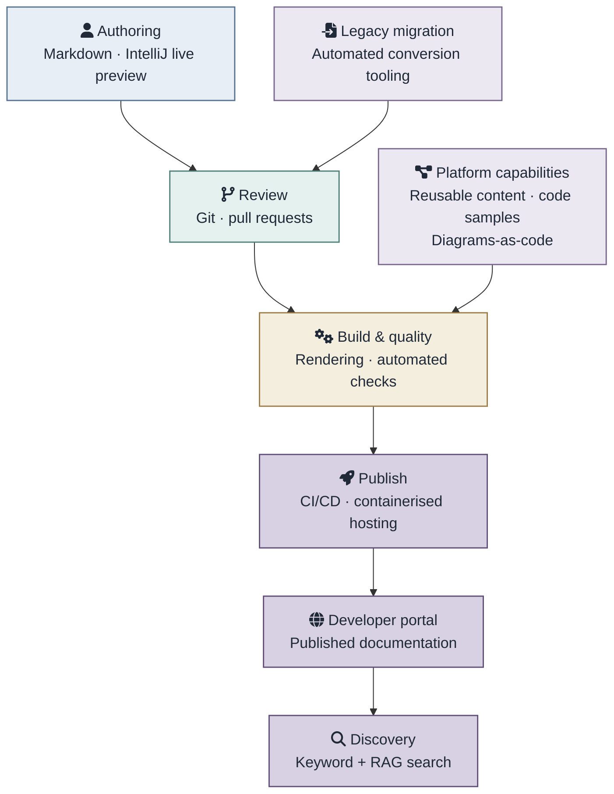

---
organisations:
  - morgan-stanley
title: Scaling an Enterprise Developer Docs Platform
description: How I scaled a custom enterprise docs-as-code platform from 700 to over 3,200 pages for
  a large developer community
slug: /case-studies/scalingdeveloperdocs
sidebar_position: 2
type:
  - case-study
audiences:
  - developers
  - documentation-managers
  - technical-writers
topics:
  - docs-as-code
  - documentation-engineering
  - developer-experience
  - information-architecture
  - documentation-governance
technologies:
  - git
  - markdown
  - intellij-idea
  - plantuml
  - mermaid
  - c4-model
  - amp
  - agentic-ai
  - vale
  - languagetool
lifecycle:
  - current
sidebar_custom_props:
  caseStudyCard:
    title: Enterprise Documentation Platform
    tag: Documentation platform
    description: Led the design, launch and growth of a custom docs-as-code platform at Morgan Stanley.
    highlights:
      - Led platform direction as documentation grew from 700 to more than 3,200 pages
      - Built migration tools that converted approximately 900 legacy pages
    ariaLabel: Read the enterprise documentation platform case study
tags:
  - agentic-ai
  - amp
  - c4-model
  - developer-experience
  - docs-as-code
  - documentation-engineering
  - documentation-governance
  - git
  - information-architecture
  - intellij-idea
  - languagetool
  - markdown
  - mermaid
  - morgan-stanley
  - plantuml
  - vale
---

import SemanticLabel, {SemanticLabelGroup} from '@site/src/components/SemanticLabel';

import CaseStudySummary from '@site/src/components/CaseStudySummary';

<CaseStudySummary {...{
  "employer": "Morgan Stanley",
  "industry": "Investment banking",
  "projectType": "Internal developer platform",
  "summary": "Led an enterprise docs-as-code platform from launch to wider adoption across Morgan Stanley’s developer community.",
  "role": "Platform leadership and hands-on engineering",
  "scope": "Optimus, RICE and the wider Codetree monorepo",
  "decision": "Custom Git-based authoring with consistent rendering in IntelliJ and on the website",
  "deliverables": "Developer portal, migration tools, engineer contribution and publishing workflows",
  "evidenceTitle": "Measurable Results",
  "evidence": [
    {
      "value": "3,200+",
      "label": "Pages at maturity, up from ~700",
      "emphasis": "metric"
    },
    {
      "value": "~900",
      "label": "Legacy pages converted",
      "emphasis": "metric"
    },
    {
      "value": "15 min",
      "label": "Container build-time reduction",
      "emphasis": "metric"
    }
  ]
}} />

## Context {/* #context */}

At Morgan Stanley, I led the design, launch and evolution of a custom internal docs-as-code platform and developer portal, alongside my work as lead technical writer for the Optimus and RICE frameworks. The platform replaced fragmented legacy documentation for these frameworks with a centralised system using Git-based workflows that made it easier for engineers and technical writers to create, maintain, review and discover content. Initially developed to support Optimus and RICE, the platform expanded to serve the documentation needs of the wider Codetree ecosystem - a large-scale monorepo containing more than 40 million lines of code.

I owned platform direction, requirements, testing and quality, working with a dedicated engineering team on the initial implementation. I later contributed directly to the codebase, extending functionality and resolving issues as adoption grew.

### Documentation content {/* #documentation-content */}

Optimus and RICE are closely related internal platforms used by developers and quantitative analysts at Morgan Stanley.

**Optimus** provides a graph-based distributed computation engine that supports automatic parallelisation, caching and large-scale *what-if* scenario analysis. Its `@node` and `@tweak` mechanisms enable calculations to be evaluated under alternative financial scenarios without modifying underlying objects. The framework is built on Scala and functional programming principles.

The platform also includes a common UI framework and a Data Access Layer (DAL) for bitemporal data storage, supporting historical data queries and integrating with Apache Kafka.

**RICE** provides the financial modelling and application environment, supporting business logic, pricing, valuation and risk calculations.

Some of the underlying technology is publicly available in the [Optimus Cirrus GitHub repository](https://github.com/morganstanley/optimus-cirrus). The technology is described in more detail [in this article](../misc/OptimusRICE.md).

## Challenge {/* #challenge */}

* Replace fragmented documentation spread across legacy documentation systems with a single platform.
* Make documentation contributions practical and as easy as possible for a large engineering community.
* Store the documentation in Git alongside the code in the main Codetree monorepo.
* Provide scalable publishing, search, and navigation.
* Migrate valuable legacy content to the new platform without manually rewriting hundreds of pages.
* Maintain and evolve the platform as usage and content volume increased.
* Provide live IntelliJ previews of complex documentation, including embedded source code, diagrams and mathematical equations, with consistent rendering on the published website.

## Approach {/* #approach */}

### Why docs as code and why build a custom platform? {/* #why-docs-as-code-and-why-build-a-custom-platform */}

Developers were already writing simple Markdown files alongside their code instead of using the existing wiki-based authoring tools, but they had no dedicated tooling or publishing environment to support that way of working.

Instead of trying to corral developers back into a separate documentation system, I chose to support the way they were already working and keep ownership with the teams closest to the technical knowledge.

<SemanticLabelGroup>

<SemanticLabel type="decision" appearance="row">
  Build a custom documentation platform around an existing Markdown rendering engine, using the same engine for IntelliJ previews and website generation.
</SemanticLabel>

<SemanticLabel type="rationale" appearance="row">
  The MkDocs pilot validated the docs-as-code approach, but interactions between the required plugins prevented reliable builds and accurate previews of complex content.
</SemanticLabel>

<SemanticLabel type="trade-off" appearance="row">
  A custom platform required greater investment, but provided control over rendering, publishing and the integration of documentation features.
</SemanticLabel>

</SemanticLabelGroup>

In the pilot, MkDocs' incremental build capability failed to work correctly with the required plugin set, limiting its usefulness as an alternative to an accurate IDE preview of plugin-generated content. I also had to extend some of the default MkDocs plugins with custom code.

The custom platform supported source-code injection and custom Markdown extensions. Its website generator added publishing-specific capabilities such as navigation and fast JavaScript-based search. Implementing the platform in Scala, the primary language of the monorepo, also allowed the wider engineering community to maintain and extend it.

### Documentation platform workflow {/* #documentation-platform-workflow */}

The platform supported the full documentation lifecycle, from Markdown authoring and Git-based review through automated build, publishing and discovery.

### Design priorities {/* #design-priorities */}

The design focused on four priorities:

* reducing friction for documentation contributions and corrections
* encouraging adoption by allowing developers to edit code and documentation together, use familiar IDE tools such as project-wide find and replace, and accurately preview documentation without switching environments or running local website builds
* designing search and information architecture that could scale with a large technical documentation set
* using analytics to identify high-value legacy content and prioritise migration.

## Implementation {/* #implementation */}

I worked with engineers from the internal tooling team to build the authoring experience within the IDE and create a published developer portal.

### Authoring and publishing {/* #authoring-and-publishing */}

* **Markdown-based documentation stored and reviewed in Git alongside the code**. Storing documentation in Git provided stronger change control than the previous wiki-based systems. Related updates across multiple pages could be reviewed and merged as a single atomic change, reducing the risk of publishing partially updated or internally inconsistent documentation. It also made the documentation easier to integrate with GenAI workflows.

* **A CI/CD-based documentation build and publishing pipeline with automated quality checks**. Documentation changes in the monorepo were incorporated into automated website builds, while checks such as link validation caught issues before publication, preventing broken internal links and improving the reliability of the documentation.

* **An IntelliJ plugin for documentation authoring and live preview**. At release, the plugin supported embedded source-code fragments, LaTeX equations and Graphviz diagrams with hyperlinks. This lowered the barrier for developers to contribute documentation by allowing them to edit and preview complex content directly within their existing development environment, with rendering consistent with the published website. I later extended the diagram support, as described under [Platform evolution](#platform-evolution).

* **Support for diagrams-as-code, including software architecture diagrams**. This enabled engineers to create and maintain explanatory diagrams without specialist graphical skills, while keeping diagrams version-controlled alongside the documentation.

* **The ability to reuse content across documentation pages and embed complete source files or selected code fragments identified by delimiters**. This reduced duplication and maintenance effort by allowing code examples to be maintained alongside the source code they documented.

### Search and navigation {/* #search-and-navigation */}

I designed the search approach for a growing documentation set, combining fast, keyword-based JavaScript client-side search with the slower corporate RAG-based search for more complex natural-language queries. I also tested search behaviour and retrieval quality; the engineering team implemented the production solution.

### Content migration {/* #content-migration */}

I migrated approximately **700 Optimus and RICE pages** and redesigned their combined information architecture. A later migration of around **200 pages** brought the total converted to approximately **900 pages**.

I developed automated content migration tooling for several legacy documentation systems, reducing manual effort and preserving information hierarchy, images, internal links, complex tables, code samples, mathematical equations, and Dot-format diagrams in the platform’s extended Markdown format.

I subsequently created IDE-based tooling that allowed content owners to migrate and validate their own documentation, making the migration process more scalable.

### Platform evolution {/* #platform-evolution */}

I led the migration of the documentation platform to the firm’s new containerised hosting solution with a custom domain, implementing redirects for legacy URLs and resolving minor post-launch issues.

<SemanticLabel type="decision">
  I proposed serving generated documentation from an attached filesystem instead of copying it into the container image.
</SemanticLabel>

<SemanticLabel type="outcome" appearance="accent">
  This reduced build time by approximately **15 minutes**.
</SemanticLabel>

As the platform matured, I contributed directly to its codebase using agentic AI-assisted development. I added PlantUML support, enabling C4 architecture diagrams, followed later by Mermaid and Structurizr. I also diagnosed and fixed bugs in the link-checking implementation.

## Impact {/* #impact */}

The platform grew from approximately **700 pages to more than 3,200 pages over three years**, through a combination of my own documentation work, content migrations and contributions from the wider engineering community.

The project helped establish documentation as a normal part of the engineering workflow. Engineers were able to avoid context switching from their IDE to a separate documentation tool. This reduced friction led to a sustained increase in contributions and corrections.

## Lessons learned {/* #lessons-learned */}

* Define and implement a structured documentation metadata taxonomy, covering ownership, lifecycle status, audience, review cadence and content type, early in the development of a documentation platform. My current portfolio integrates [a canonical taxonomy and associated governance system](./TaxonomyGovernance.md).

* Add a full set of automated quality checks to documentation pull requests beyond simple link checking, using tools such as Vale and LanguageTool together with AI-assisted checks for style-guide conformance, consistency and other content-quality issues. This would help to ensure that quality scales with the growth of the site once manual review of every PR is no longer practical and is especially important when engineers use GenAI assisted authoring. My [portfolio integrates these checks](./DocusaurusPortfolio.md).
