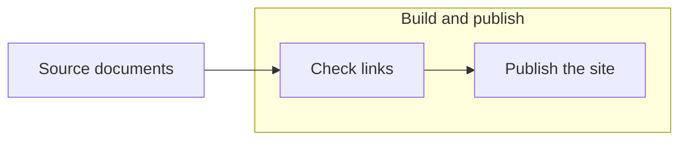

import DiagramFigure from '@site/src/components/DiagramFigure';
import CodeBlock from '@theme/CodeBlock';

`DiagramFigure` wraps a Mermaid diagram with a caption, a legend and a full-screen viewer. Readers can change the layout, zoom into a subgraph and share a link that opens the same view.

## Import

Import the component into your Docusaurus Markdown or MDX page.

```jsx
import DiagramFigure from '@site/src/components/DiagramFigure';
```

## Shareable diagram with a subgraph note

Open the rendered figure full-screen and choose **Build and publish** from **Zoom to**. **Copy diagram link** captures the selected subgraph and layout. The note appears next to the subgraph when it fits, and narrow screens show it in an expandable section.

The table shows the authoring source beside the live component. On narrow screens, scroll the table horizontally to compare the two columns.

<table>
<thead><tr><th scope="col">Raw text</th><th scope="col">Rendered version</th></tr></thead>
<tbody><tr>
<td><CodeBlock language="mdx">{"\u003cDiagramFigure {...{\n  \"title\": \"Documentation publishing\",\n  \"shareId\": \"documentation-publishing\",\n  \"legend\": [\n    {\"role\": \"input\", \"label\": \"Source documents\"},\n    {\"role\": \"process\", \"label\": \"Build and publication\"}\n  ],\n  \"subgraphNotes\": {\n    \"BUILD\": \"The build checks links before publishing the static site.\"\n  }\n}}>\n\n```mermaid\nflowchart LR\n  accTitle: Documentation publishing\n  accDescr {\n    Source documents enter a build that checks links before the site is published.\n  }\n  Docs[\"Source documents\"] --> Check\n  subgraph BUILD[\"Build and publish\"]\n    Check[\"Check links\"] --> Publish[\"Publish the site\"]\n  end\n  class Docs input;\n  class Check,Publish process;\n```\n\n\u003c/DiagramFigure"}</CodeBlock></td>
<td style={{minWidth: '32rem', verticalAlign: 'top'}}>

<DiagramFigure {...{
  "title": "Documentation publishing",
  "shareId": "documentation-publishing",
  "legend": [
    {"role": "input", "label": "Source documents"},
    {"role": "process", "label": "Build and publication"}
  ],
  "subgraphNotes": {
    "BUILD": "The build checks links before publishing the static site."
  }
}}>



</DiagramFigure>

</td>
</tr></tbody>
</table>

## DiagramFigure props

| Prop | Default | Usage | Example |
| --- | --- | --- | --- |
| `title` | Required | Visible figure caption. Figures are numbered in document order. | `"Documentation publishing"` |
| `shareId` | Omitted | Stable ID for the figure anchor and viewer links. | `"documentation-publishing"` |
| `legend` | Required | Each entry names a role and can override its default label. The role supplies the colour. | `[{"role": "input", "label": "Source documents"}, {"role": "process", "label": "Build and publication"}]` |
| `subgraphNotes` | Omitted | Maps Mermaid subgraph IDs to note text. For a multi-panel figure, group notes by panel ID first. | `{"BUILD": "The build checks links before publishing the static site."}` |
| `children` | Required | Mermaid fence or diagram panels inside the figure. | A `mermaid` fence beginning with `flowchart LR`. |

## Authoring and maintenance

- Keep `shareId` stable when changing the caption or figure number. Existing links use it to find the figure.
- Give each Mermaid diagram an `accTitle` and `accDescr` that describe the flow and its purpose.
- Assign palette roles with Mermaid `class` statements and use the same roles in the legend.
- Match each note key to the authored subgraph ID. The example uses `BUILD` in both places.

The [RAG case study](../case-studies/RagSearchCloudArchitecture.md#architecture) uses the viewer with a multi-panel figure. See [Diagramming and Technical Visualisation](../tools/Diagramming.md) for the broader diagramming work.
