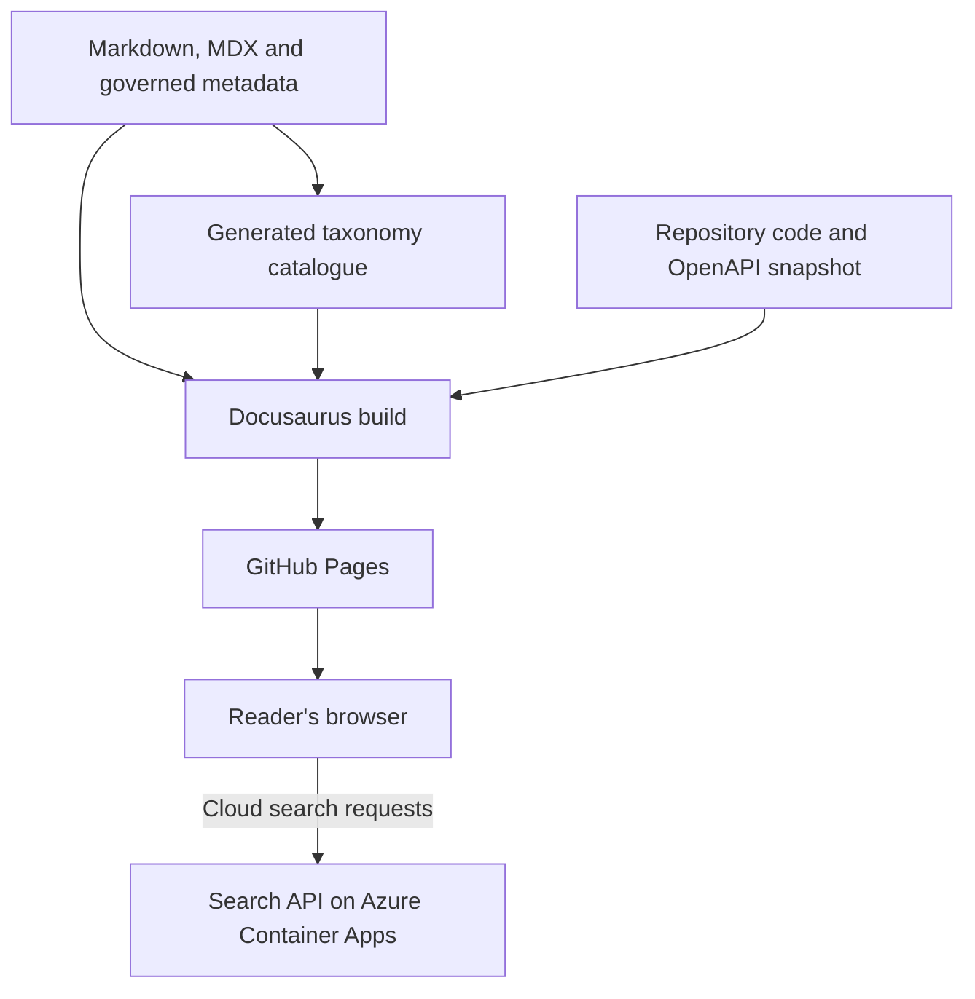

import DiagramFigure from '@site/src/components/DiagramFigure';

The [Docusaurus Portfolio case study](../case-studies/DocusaurusPortfolio.md) describes the project's decisions and outcomes. Use this guide to trace a change through the build, identify the generated files it affects and verify the published result.

## System architecture

Docusaurus builds the site from Markdown and MDX, governed frontmatter, and repository files. The browser reads the generated catalogue for local browsing and loads the committed OpenAPI snapshot for the API reference. Only the cloud search features call the API on Azure Container Apps.

<DiagramFigure {...{
  "title": "Portfolio build and search architecture",
  "shareId": "portfolio-build-and-search-architecture",
  "legend": [
    {"role": "input", "label": "Repository inputs"},
    {"role": "storage", "label": "Generated catalogue"},
    {"role": "process", "label": "Build, hosting and runtime"}
  ]
}}>



</DiagramFigure>

### Local catalogue and recommendations

The [taxonomy tooling](taxonomy.md) validates frontmatter against the controlled vocabulary and generates `src/generated/taxonomy-navigation.json`. The Explore interface ranks matches by title, description and metadata, with prefix matching and conservative typo tolerance. Facet counts show readers how many documents match the available filters. Article-body retrieval runs through the [cloud search architecture](../case-studies/RagSearchCloudArchitecture.md).

The See also plugin runs during development and production builds. It uses document metadata to select up to three recommendations, favouring distinctive shared topics and technologies. Authors can exclude destinations or disable recommendations for a page. The generated review report records why each link was selected. See [the repository's See also instructions](https://github.com/iand4096/docusaurusportfolio#generated-see-also-links) for configuration and maintenance.

### Code excerpts and API examples

The source snippets plugin reads regions delimited by `docs:start` and `docs:end` comments. In a Markdown or MDX page, add an empty fenced code block with a language and a `source=path#name` attribute. The repository path and region name identify the excerpt. The rendered block provides **Copy code** and a **View source** link to the excerpt in the published source snapshot. See the [QA adapter example](qa-key-concepts.md#check-adapters-and-shared-results).

FastAPI's `app.openapi()` generates the contract from route definitions, data models and named examples. The exporter saves a snapshot in `static/api/search-openapi.json`. Docusaurus publishes it with the site, and Scalar loads it in the browser for the [Search API reference](pathname:///search-api). The [API documentation components](api-example.mdx) use operation IDs and named examples from the same snapshot to render operation links, request and response payloads, and cURL examples.

For other authoring patterns, see [capability grids](capability-grid.mdx), [semantic labels](semantic-label.mdx), [project summaries and navigation cards](case-study-summary-and-sidebar-card-grid.mdx), and [diagram figures](diagram-figure.mdx).

### Markdown exports

The production build generates `llms.txt`, `llms-full.txt` and individual Markdown exports, retaining governed taxonomy fields. Documentation pages provide **View Markdown** and **Copy page as Markdown**, including a manual copy option when the clipboard is unavailable. Run a production build and serve it locally to preview the exports.

## Build and publishing workflow

1. **Validate repository inputs.** Pull request workflows check taxonomy and changed document metadata, verify the committed See also files and detect drift in the OpenAPI snapshot. Documentation QA also makes review reports available as workflow artifacts.
2. **Build the site.** The deployment workflow builds Docusaurus, including generated discovery data, repository excerpts, static API documentation and Markdown exports.
3. **Generate and verify the QA report.** The workflow runs deterministic checks and evidence-validated AI review. It clears stale outputs and verifies that the new report belongs to the revision being deployed before adding it to the site bundle.
4. **Publish and enforce the QA result.** GitHub Pages receives the site and the verified report. The QA gate reports its result separately, so a threshold failure leaves the [published report](pathname:///qa/) available for inspection. For thresholds, provenance checks and feedback workflows, see [Documentation QA](qa-overview.md) and [QA reports and CI policy](qa-reports-and-ci.mdx).

## Validate and maintain generated outputs

| Change | Update and verify |
| --- | --- |
| Document metadata or canonical vocabulary | Run `npm run taxonomy:generate` and `npm run taxonomy:check`. Review the generated catalogue. |
| Content or metadata that affects recommendations | Run `npm run see-also:generate` after any catalogue regeneration. Review and commit `src/generated/see-also.json` and `reports/see-also.md`, then run `npm run see-also:check`. |
| A Search API route, model or named example | Regenerate and commit the OpenAPI snapshot with the API change. Use Linux, Python 3.12 and the dependencies pinned in `knowledge-api/requirements-openapi-linux-py312.lock` to match CI. |
| A code region, plugin or exported page | Run `npm run build`, then `npm run serve`. Open the affected page and verify its code, source link or Markdown export. |

Run the OpenAPI commands from the repository root with the pinned dependencies installed.

```bash
python knowledge-api/export_openapi.py
python knowledge-api/export_openapi.py --check
```

The check compares the committed snapshot to the schema FastAPI currently generates and fails if the snapshot is missing or differs. The [Search API validation workflow](https://github.com/iand4096/docusaurusportfolio/blob/main/.github/workflows/search-openapi.yml) runs the same check in CI.
