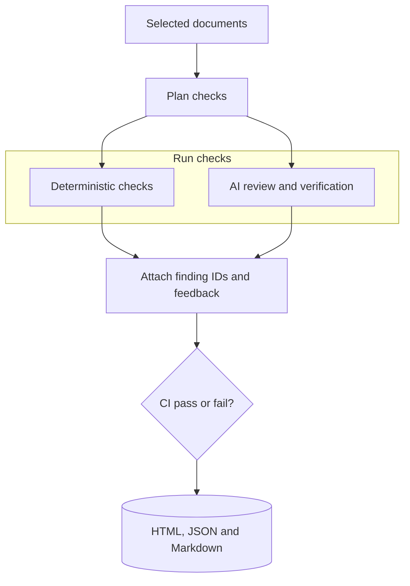
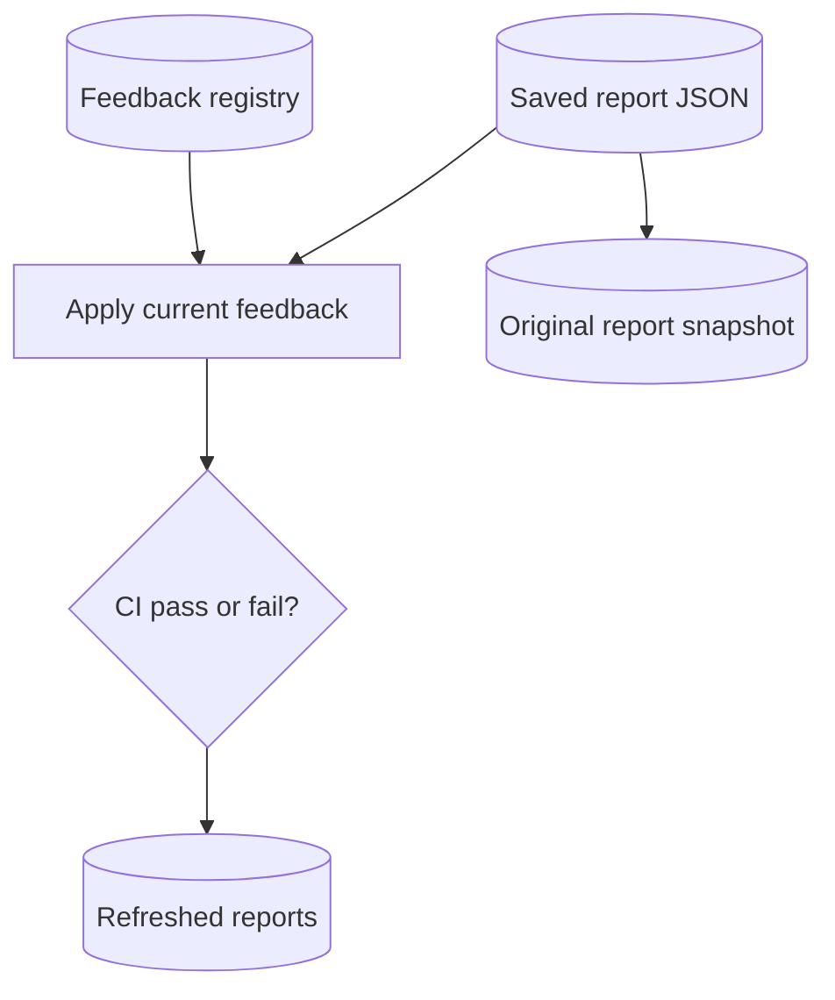

import DiagramFigure from '@site/src/components/DiagramFigure';

The documentation QA pipeline runs deterministic checks and AI-assisted review, attaches any recorded feedback, and writes HTML, JSON and Markdown reports. The same CLI can refresh a saved report after a feedback decision.

## Pipeline

A fresh review selects the default documentation paths and any explicit `--include-file` inputs. The runner shares loaded text across page and site-wide checks. File tools receive paths and read from disk. After execution, the CLI assigns finding identities, attaches feedback and, when DeepSeek is enabled and credentials are available, can compare possible recurrences.

### Review and report flows

<DiagramFigure {...{
  "title": "Documentation QA and saved-report refresh",
  "shareId": "documentation-qa-review-flows",
  "legend": [
    {"role": "input", "label": "Review inputs"},
    {"role": "process", "label": "Pipeline stages"},
    {"role": "generation", "label": "AI review"},
    {"role": "storage", "label": "Saved reports"},
    {"role": "decision", "label": "CI result"}
  ]
}}>

#### Fresh review

#### Saved-report refresh

</DiagramFigure>

For the decision and commands a reader uses after a review, see [Refresh or rerun](qa-read-report.md#refresh-or-rerun).

## Module map

| Module | Responsibility |
| --- | --- |
| `scripts/ai_docs_review.py` | CLI, document discovery, check selection, feedback commands and report orchestration. |
| `scripts/qa_runner.py` and `scripts/qa_checks/` | Execution plan, shared source text, external-tool adapters and typed findings and errors. |
| `scripts/qa_ai/` and `scripts/qa_review_cache.py` | DeepSeek requests, prompts, genre routing, evidence verification and the cache for completed AI checks. |
| `scripts/qa_feedback.py` and `scripts/qa_recurrence.py` | Finding and occurrence IDs, feedback history, recurrence comparison and human-approved decision reuse. |
| `scripts/qa_policy.py` and `scripts/qa_reporting/` | CI eligibility and thresholds, report model and format-specific renderers. |

- [Documentation QA CLI reference](qa-cli-reference.md)
- [Read a QA report and act on findings](qa-read-report.md)
- [Add a documentation checker](qa-add-checker.mdx)
- [Change AI review behaviour](qa-ai-review.mdx)
- [Change QA reports or CI policy](qa-reports-and-ci.mdx)
- [Finding identity, feedback and recurrence](qa-feedback.md)
