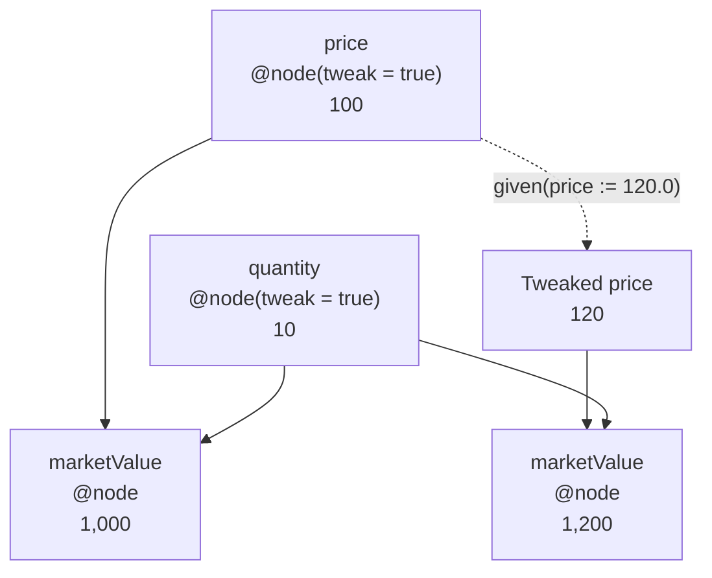

import DiagramFigure from '@site/src/components/DiagramFigure';

# Optimus and RICE - distributed computing and financial analytics

## Overview {/* #overview */}

Morgan Stanley uses RICE and Optimus to run financial applications. **RICE (Risk Calculation Environment)** provides the analytics environment for pricing and risk. **Optimus** is the Scala computation framework that runs calculations at scale.

This technical reference draws on publicly available material. The code and valuation examples are illustrative. See [Public references](#public-references) for the sources.

## Platform architecture {/* #platform-architecture */}

### 1. Financial applications and analytics - RICE {/* #1-financial-applications-and-analytics---rice */}

Developers build pricing, valuation and risk applications on RICE. Optimus runs independent calculations in parallel, and reactive interfaces display financial data and results.

RICE supports trading and risk management in Fixed Income.

### 2. Graph computation framework - Optimus {/* #2-graph-computational-framework---optimus */}

Optimus builds its dependency graph from methods marked `@node`. When one node calls another, the runtime can tell which result it needs before it can continue. Optimus uses those dependencies to run independent tasks in parallel and cache results. [Scala Days 2023][scala-days]

When a calculation has the same inputs and execution context, the runtime can reuse the result. This is the practical benefit of **referential transparency**. To test a scenario, a developer can temporarily override an input with a *tweak*. The original object keeps its value outside the scenario.

#### 1. Code example

In this Scala-style pseudocode, a price tweak changes the trade's value from 1,000 to 1,200 inside the `given` block.

```scala
@entity
class Trade(
  @node(tweak = true) val price: Double,
  @node(tweak = true) val quantity: Int
) {
  @node
  def marketValue: Double = price * quantity
}

// Assuming price = 100 and quantity = 10
trade.marketValue  // 1000

given(trade.price := 120.0) {
  trade.marketValue  // 1200
}

trade.marketValue  // 1000 (original value)
```

#### 2. Dependency diagram

<DiagramFigure {...{
  "title": "Calculation dependencies and price tweaks",
  "shareId": "calculation-dependencies-and-price-tweaks",
  "legend": [
    {
      "role": "input",
      "label": "Original and scenario inputs"
    },
    {
      "role": "process",
      "label": "Calculated results"
    }
  ]
}}>



</DiagramFigure>

### 3. Data access layer - DAL {/* #3-data-access-layer---dal */}

**Bitemporal object storage** records two kinds of time.

- **Valid time:** When information is effective in the business domain.
- **Transaction time:** When information is recorded in the data store.

Together, [valid time and transaction time][temporal] let you ask what was effective on a date and what the system knew about it when a calculation ran.

### 4. Distributed execution and infrastructure {/* #4-distributed-execution-and-infrastructure */}

In its [2023 Scala Days talk][scala-days], Morgan Stanley described Optimus Cirrus running across thousands of compute nodes with more than a petabyte of RAM in total.

AWS also reported at [re:Invent 2023][aws-hpc] that Morgan Stanley used AWS and Azure for compute-intensive RICE risk calculations.

### 5. Developer tooling and compiler infrastructure {/* #5-developer-tooling-and-compiler-infrastructure */}

The **Optimus Build Tool (OBT)** distributes compilation work and caches build results. Morgan Stanley demonstrated OBT on approximately 21 million lines of Scala and Java at [Scala Days 2023][scala-days].

## End-to-end calculation workflow {/* #end-to-end-calculation-workflow */}

This illustrative valuation shows how the pieces can fit together.

1. A financial application initiates a calculation using a model developed in the RICE environment.
2. Optimus evaluates the model's dependency graph, coordinating the computations and reusing eligible cached results.
3. The application and its computations obtain required financial information through DAL services, including historical data where appropriate.
4. Results are returned for use by financial applications, analytical services or user interfaces, with distributed compute and data infrastructure supporting the workload.

## Engineering significance {/* #engineering-significance */}

Suppose a price correction comes in on Tuesday and applies to Monday. To reproduce Monday’s original valuation, select prices valid on Monday and use the data the system had when it ran the calculation. To recalculate Monday’s valuation with the correction, keep Monday as the valid date and advance the transaction time to include Tuesday’s update. [Valid time and transaction time][temporal]

## Public references {/* #public-references */}

1. [Morgan Stanley — Optimus Cirrus GitHub repository][cirrus]\
   Includes the [Data Access Layer (DAL) source code][dal-source] and the code used to compile the Optimus Build Tool.

2. **Scala Days 2023 — Supercharge Your Performance with the Optimus Cirrus Platform**  
   Functional programming, parallelisation, caching, distributed computation and OBT.  
   https://archives.scaladays.org/2023/seattle-2023/supercharge-your-performance-with-the-optimus-cirrus-platform.html

3. [Morgan Stanley — Simulated Change of Immutable Objects During Execution Runtime][tweak-patent]\
   Describes referentially transparent nodes, scenario evaluation and caching. Its examples include a sale with tweakable price and quantity and a scoped price change using `given`.

4. **University of Cambridge — Functional Languages and Financial Models (2014)**\
   Graph programming, functional financial models, Scala and risk infrastructure.  
   https://www.cst.cam.ac.uk/seminars/list/55917

5. [Morgan Stanley — Scala Developer, Interest Rate Derivatives][pricing-role]\
   Describes a pricing system built on Optimus and RICE to run computationally intensive calculations in parallel.

6. [Morgan Stanley — Commodities Strategist][commodities-role]\
   Describes work to move Commodities products and workflows onto RICE.

7. [Peter Fraenkel — RICE engineering overview][rice-overview]\
   Describes RICE’s Fixed Income role, reactive user interfaces and bitemporal object storage, along with work on the Scala compiler, asynchronous execution and embedded query languages.

8. [AWS re:Invent 2023 — Confidently run your production HPC workloads on AWS][aws-hpc]\
   Reports the use of AWS and Azure for RICE risk calculations.

9. [Jensen and Snodgrass — Bitemporal Interval][temporal]\
   Defines valid time and transaction time for bitemporal data.

**Valuation example.** The workflow combines public descriptions of [Optimus and RICE pricing][pricing-role], [data access][dal-source] and [scenario evaluation][tweak-patent].

[cirrus]: https://github.com/morganstanley/optimus-cirrus

[scala-days]: https://archives.scaladays.org/2023/seattle-2023/supercharge-your-performance-with-the-optimus-cirrus-platform.html

[tweak-patent]: https://patents.google.com/patent/US20220121462A1/en

[pricing-role]: https://en.wizbii.com/company/morgan-staney/job/scala-developer-7

[commodities-role]: https://ms.wd5.myworkdayjobs.com/en-US/External/job/Commodities-Strategist_JR041944

[rice-overview]: https://www.linkedin.com/posts/peter-fraenkel-3849493_hiring-activity-6877297325576904704-bYFO

[dal-source]: https://github.com/morganstanley/optimus-cirrus/tree/main/optimus/platform/projects/dal_core

[aws-hpc]: https://d1.awsstatic.com/events/Summits/reinvent2023/CMP213_Confidently-run-your-production-HPC-workloads-on-AWS.pdf

[temporal]: https://www2.cs.arizona.edu/~rts/pubs/TRmerged.pdf
