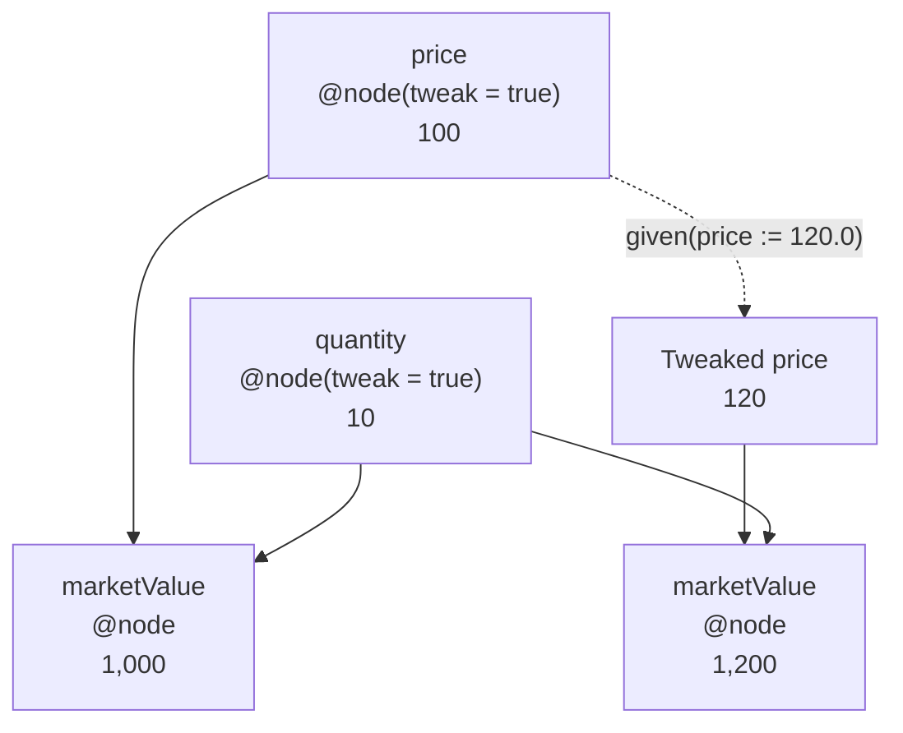

import DiagramFigure from '@site/src/components/DiagramFigure';

# Optimus and RICE - distributed computing and financial analytics

## Overview {/* #overview */}

Morgan Stanley's RICE (**RIsk Calculation Environment**) and Optimus support computationally intensive financial applications.

- **RICE** provides the financial analytics environment for pricing, valuation, trading and risk management. Morgan Stanley describes it as a Fixed Income risk framework and has advertised roles supporting the migration of Commodities products and workflows to it. [Fixed Income and DAL role][dal-role] · [Commodities Strategist role][commodities-role]
- **Optimus** is a Scala-based, graph-oriented computation framework built on functional programming principles. It manages computational dependencies and supports automatic parallelisation, asynchronous execution, caching and scenario evaluation. [Scala Days keynote][scala-days] · [Scenario evaluation patent][tweak-patent]

Within the RICE platform, the **Data Access Layer (DAL)** provides distributed data services, including bitemporal storage and retrieval. [DAL role][dal-role]

## Platform architecture {/* #platform-architecture */}

These components describe architectural responsibilities, not a strict product hierarchy. Infrastructure and tooling cut across them.

### 1. Financial applications and analytics - RICE {/* #1-financial-applications-and-analytics---rice */}

RICE provides a platform for building financial models and applications for pricing, valuation, trading and risk. The platform's development and runtime teams provide services and components used by application developers. [Optimus/RICE pricing role][pricing-role] · [Fixed Income and DAL role][dal-role]

The ecosystem also includes declarative reactive interfaces for presenting financial data and results. [Fixed Income and DAL role][dal-role]

### 2. Graph Computational framework - Optimus {/* #2-graph-computational-framework---optimus */}

Optimus uses a dependency-driven computation graph. Methods annotated with `@node` participate in that graph, allowing the runtime to manage dependencies and coordinate execution. Its model supports asynchronous evaluation, automatic parallelisation, memoization and caching. [Scala Days keynote][scala-days] · [Scenario evaluation patent][tweak-patent]

Optimus builds a dependency graph from computations defined using `@node`. A node can invoke other nodes, which may themselves have further dependencies, creating a graph of interconnected calculations.

**Referential transparency** is an important principle: results can be reused safely when a function's inputs and execution context remain unchanged. For scenario analysis, tweaks let nodes be evaluated under alternative assumptions while preserving the underlying immutable objects.

The Scala-style pseudocode below illustrates that behaviour. Morgan Stanley's patent describes a sale with tweakable price and quantity and gives a separate example of a scoped price change using `given`. [Scenario evaluation patent][tweak-patent]

```scala
@entity
class Trade(
  @node(tweak = true) val price: Double,
  @node(tweak = true) val quantity: Int
) {
  @node
  def marketValue: Double = price * quantity
}

// Assuming price = 100 and quantity = 10
trade.marketValue  // 1000

given(trade.price := 120.0) {
  trade.marketValue  // 1200
}

trade.marketValue  // 1000 (original value)
```

The diagram illustrates the dependencies in the example:

<DiagramFigure {...{
  "title": "Calculation dependencies and price tweaks",
  "shareId": "calculation-dependencies-and-price-tweaks",
  "legend": [
    {
      "role": "input",
      "label": "Original and scenario inputs"
    },
    {
      "role": "process",
      "label": "Calculated results"
    }
  ]
}}>



</DiagramFigure>

### 3. Data access layer - DAL {/* #3-data-access-layer---dal */}

DAL provides data storage, retrieval and distribution capabilities. A defining feature is **bitemporal object storage**, which tracks two distinct dimensions:

- **Valid time:** When information is effective in the business domain.
- **Transaction time:** When information is recorded in the data store.

This distinction lets users reconstruct which facts were effective at a given time and which facts the system knew at that time. [Valid time and transaction time][temporal]

Morgan Stanley describes DAL as distributed, strongly consistent data infrastructure integrating MongoDB, PostgreSQL, Apache Kafka, and internal and external cloud platforms. It serves applications and large compute grids. [DAL role][dal-role]

### 4. Distributed execution and infrastructure {/* #4-distributed-execution-and-infrastructure */}

At Scala Days 2023, Morgan Stanley described **Optimus Cirrus** as automatically caching and parallelising tasks across thousands of compute nodes with more than a petabyte of aggregate RAM. [Scala Days keynote][scala-days]

AWS reported in 2023 that Morgan Stanley used AWS and Azure to run compute-intensive RICE risk calculations. [AWS re:Invent HPC presentation][aws-hpc]

### 5. Developer tooling and compiler infrastructure {/* #5-developer-tooling-and-compiler-infrastructure */}

The ecosystem includes specialised Scala compiler development, asynchronous programming semantics, embedded query languages and developer tooling. [Fixed Income and DAL role][dal-role] · [Optimus Cirrus source][cirrus]

One related capability is the **Optimus Build Tool (OBT)**, which applies distributed computation and caching techniques to software compilation. Morgan Stanley has demonstrated the approach on a codebase containing approximately 21 million lines of Scala and Java. OBT applies Optimus concepts outside the financial calculation workflow. [Scala Days keynote][scala-days]

## End-to-end calculation workflow {/* #end-to-end-calculation-workflow */}

This illustrative valuation or risk calculation combines the roles described in public sources. [Optimus/RICE pricing role][pricing-role] · [DAL role][dal-role] · [Scenario evaluation patent][tweak-patent]

1. A financial application initiates a calculation using a model developed in the RICE environment.
2. Optimus evaluates the model's dependency graph, coordinating the computations and reusing eligible cached results.
3. The application and its computations obtain required financial information through DAL services, including historical data where appropriate.
4. Results are returned for use by financial applications, analytical services or user interfaces, with distributed compute and data infrastructure supporting the workload.

The sequence illustrates how Optimus and DAL can provide complementary computation and data services for financial applications.

## Engineering significance {/* #engineering-significance */}

Taken together, the public descriptions suggest that the architecture separates financial modelling from execution and data access. This separation can reduce the need for application teams to implement dependency scheduling, result reuse and history queries themselves. [Fixed Income and DAL role][dal-role] · [Scenario evaluation patent][tweak-patent]

Developers must understand **calculation dependencies and execution contexts** to reason about caching and scenario behaviour. They must also distinguish **business-effective history from system-recorded history** when reproducing a past valuation or explaining a risk result. At deployment scale, distributed computation and strongly consistent data access introduce additional operational and integration concerns.

## Public references {/* #public-references */}

1. **Morgan Stanley — Optimus Cirrus GitHub Repository**  
   Public source code, project scope, licensing and technical presentations.  
   https://github.com/morganstanley/optimus-cirrus

2. **Scala Days 2023 — Supercharge Your Performance with the Optimus Cirrus Platform**  
   Functional programming, parallelisation, caching, distributed computation and OBT.  
   https://archives.scaladays.org/2023/seattle-2023/supercharge-your-performance-with-the-optimus-cirrus-platform.html

3. **Morgan Stanley — Simulated Change of Immutable Objects During Execution Runtime**\
   Patent describing referentially transparent nodes, tweaks, scenario-based evaluation and caching.  
   https://patents.google.com/patent/US20220121462A1/en

4. **University of Cambridge — Functional Languages and Financial Models (2014)**\
   Graph programming, functional financial models, Scala and risk infrastructure.  
   https://www.cst.cam.ac.uk/seminars/list/55917

5. **Morgan Stanley — Scala Developer, Interest Rate Derivatives**\
   Public description of valuation systems built on the Optimus/RICE platform.  
   https://en.wizbii.com/company/morgan-staney/job/scala-developer-7

6. **Morgan Stanley — Commodities Strategist**\
   Public evidence of Commodities products and workflows being migrated to the RICE platform.  
   https://ms.wd5.myworkdayjobs.com/en-US/External/job/Commodities-Strategist_JR041944

7. [Morgan Stanley — Institutional Securities Technology developer role][dal-role]\
   Describes RICE's Fixed Income role, platform capabilities, and DAL integrations.

8. [AWS re:Invent 2023 — Confidently run your production HPC workloads on AWS][aws-hpc]\
   Reports the use of AWS and Azure for RICE risk calculations.

9. [Jensen and Snodgrass — Bitemporal Interval][temporal]\
   Defines valid time and transaction time for bitemporal data.

[cirrus]: https://github.com/morganstanley/optimus-cirrus
[scala-days]: https://archives.scaladays.org/2023/seattle-2023/supercharge-your-performance-with-the-optimus-cirrus-platform.html
[tweak-patent]: https://patents.google.com/patent/US20220121462A1/en
[pricing-role]: https://en.wizbii.com/company/morgan-staney/job/scala-developer-7
[commodities-role]: https://ms.wd5.myworkdayjobs.com/en-US/External/job/Commodities-Strategist_JR041944
[dal-role]: https://sg.linkedin.com/jobs/view/associate-vp-developer-institutional-securities-technology-at-morgan-stanley-3907166911
[aws-hpc]: https://d1.awsstatic.com/events/Summits/reinvent2023/CMP213_Confidently-run-your-production-HPC-workloads-on-AWS.pdf
[temporal]: https://www2.cs.arizona.edu/~rts/pubs/TRmerged.pdf
