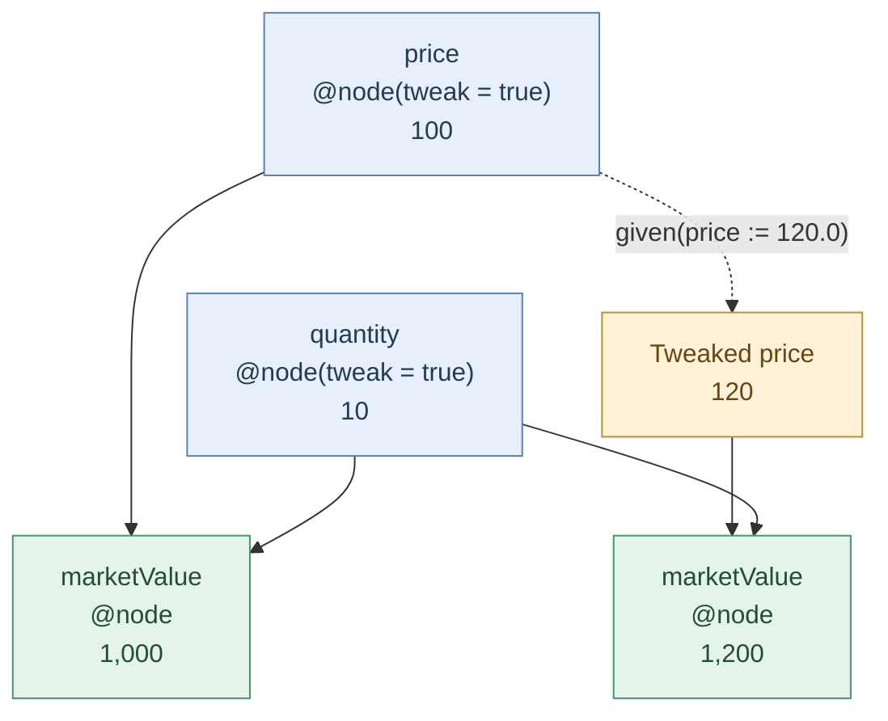

# Optimus and RICE - distributed computing and financial analytics

## Overview

Morgan Stanley's RICE (**RIsk Calculation Environment**) and Optimus support computationally intensive financial applications. **RICE** provides the financial analytics environment for pricing, valuation, trading and risk management. Originally associated with the Fixed Income business, it is also being adopted for Commodities products and workflows.

**Optimus** is a Scala-based, graph-oriented computation framework built on functional programming principles. It manages computational dependencies and supports automatic parallelisation, asynchronous execution, caching and scenario evaluation. It uses a **Data Access Layer (DAL)** that supplies distributed data services, including bitemporal storage and retrieval.

## Platform architecture

These components describe architectural responsibilities, not a strict product hierarchy. Infrastructure and tooling cut across them.

### 1. Financial applications and analytics - RICE

RICE provides the domain-specific environment for developing quantitative models and applications involving financial instruments, trading positions, pricing, valuations, profit and loss, and risk. Applications initiate calculations and consume results without implementing execution or data management themselves.

The ecosystem also includes declarative reactive interfaces for presenting financial data and results.

### 2. Graph Computational framework - Optimus

Optimus uses a dependency-driven computation graph. Methods annotated with `@node` participate in that graph, allowing the runtime to manage dependencies and coordinate execution. Its model supports asynchronous evaluation, automatic parallelisation, memoization and caching.

Optimus builds a dependency graph from computations defined using `@node`. A node can invoke other nodes, which may themselves have further dependencies, creating a graph of interconnected calculations.

**Referential transparency** is an important principle: results can be reused safely when a function's inputs and execution context remain unchanged. For scenario analysis, `@tweaks` allow tweakable nodes to be evaluated under alternative assumptions without modifying the underlying immutable domain objects. This supports recalculation under alternative market conditions or risk scenarios. A very simple example is shown below.

```scala
@entity
class Trade(
  @node(tweak = true) val price: Double,
  @node(tweak = true) val quantity: Int
) {
  @node
  def marketValue: Double = price * quantity
}

// Assuming price = 100 and quantity = 10
trade.marketValue  // 1000

given(trade.price := 120.0) {
  trade.marketValue  // 1200
}

trade.marketValue  // 1000 (original value)
```

This generates the following dependency graph:



### 3. Data access layer - DAL

DAL provides data storage, retrieval and distribution capabilities. A defining feature is **bitemporal object storage**, which tracks two distinct dimensions:

- **Valid time:** When information is effective in the business domain.
- **Transaction time:** When information is recorded in the data store.

This distinction supports historical reconstruction, risk analysis, reporting, auditing and reproducibility.

Morgan Stanley describes DAL as distributed, strongly consistent data infrastructure integrating technologies including MongoDB, PostgreSQL and Apache Kafka. It serves applications and large compute grids.

### 4. Distributed execution and infrastructure

The computation and data services operate on large-scale distributed infrastructure. At Scala Days 2023, Morgan Stanley described **Optimus Cirrus** as running across thousands of compute nodes with more than a petabyte of aggregate RAM.

RICE also integrates distributed data services with internal and external cloud platforms.

### 5. Developer tooling and compiler infrastructure

The ecosystem includes specialised Scala compiler development, asynchronous programming semantics, embedded query languages and developer tooling.

One related capability is the **Optimus Build Tool (OBT)**, which applies distributed computation and caching techniques to software compilation. Morgan Stanley has demonstrated the approach on a codebase containing approximately 21 million lines of Scala and Java. OBT applies Optimus concepts outside the financial calculation workflow.

## End-to-end calculation workflow

A conceptual valuation or risk calculation proceeds as follows:

1. A financial application initiates a calculation using a model developed in the RICE environment.
2. Optimus evaluates the model's dependency graph, coordinating the computations and reusing eligible cached results.
3. The application and its computations obtain required financial information through DAL services, including historical data where appropriate.
4. Results are returned for use by financial applications, analytical services or user interfaces, with distributed compute and data infrastructure supporting the workload.

The sequence is illustrative, not prescriptive. **RICE is the broader financial risk platform; Optimus and DAL provide complementary computational and data capabilities within that ecosystem.**

## Engineering significance

The architecture separates financial-domain concerns from general-purpose execution and data services. This reduces the need for application teams to implement their own dependency scheduling, result reuse and historical data access, while introducing important design considerations.

Developers must understand **calculation dependencies and execution contexts** to reason about caching and scenario behaviour. They must also distinguish **business-effective history from system-recorded history** when reproducing a past valuation or explaining a risk result. At deployment scale, distributed computation and strongly consistent data access introduce additional operational and integration concerns.

## Public references

1. **Morgan Stanley — Optimus Cirrus GitHub Repository**  
   Public source code, project scope, licensing and technical presentations.  
   https://github.com/morganstanley/optimus-cirrus

2. **Scala Days 2023 — Supercharge Your Performance with the Optimus Cirrus Platform**  
   Functional programming, parallelisation, caching, distributed computation and OBT.  
   https://archives.scaladays.org/2023/madrid-2023/keynote3.html

3. **Morgan Stanley — Institutional Securities Technology, RICE and DAL Engineering**  
   RICE architecture, bitemporal storage, reactive UIs, DAL responsibilities, data technologies and cloud integration.  
   https://sg.linkedin.com/jobs/view/associate-vp-developer-institutional-securities-technology-at-morgan-stanley-3907166911

4. **Morgan Stanley — Simulated Change of Immutable Objects During Execution Runtime**  
   Patent describing referentially transparent nodes, tweaks, scenario-based evaluation and caching.  
   https://patents.google.com/patent/US20220121462A1/en

5. **University of Cambridge — Functional Languages and Financial Models (2014)**  
   Graph programming, functional financial models, Scala and risk infrastructure.  
   https://www.cst.cam.ac.uk/seminars/list/55917

6. **Morgan Stanley — Scala Developer, Interest Rate Derivatives**  
   Public description of valuation systems built on the Optimus/RICE platform.  
   https://en.wizbii.com/company/morgan-staney/job/scala-developer-7

7. **Morgan Stanley — Commodities Strategist**  
   Public evidence of Commodities products and workflows being migrated to the RICE platform.  
   https://ms.wd5.myworkdayjobs.com/en-US/External/job/Commodities-Strategist_JR041944
