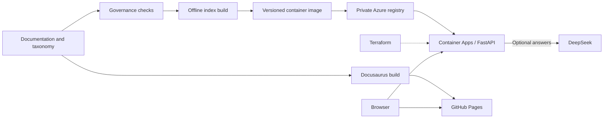

# Governed RAG search: operations and deployment

Runbook for updating the portfolio search index, releasing the FastAPI backend and Docusaurus frontend, checking the service and recovering from failures.

**Verified source baseline:** repository commit `dfd4107`. Instructions describe checked-in code, not an audit of live Azure resources. Recheck the linked implementation after changes. Image tags and revision names are release-specific.

**Command variants:** Examples on this page use Windows PowerShell and Docker Desktop. For Bash on Linux with Docker Engine/Compose, use the [Linux command reference](OPERATIONS-linux.md), covering setup, indexing, tests, smoke checks, builds, deployment, CORS and diagnostics. Both variants use Python, Node/npm, Azure CLI and Terraform. Work from your checkout; `$HOME\DocusaurusSite` below is an example location.

The only PowerShell script in this release path is `scripts/build-azure-image.ps1`; Linux uses `bash scripts/build-azure-image.sh`. Python tooling, Dockerfiles, Compose and Terraform are shared. The GitHub Actions workflows already run on Linux. PowerShell 7 can also run on Linux, but the Bash route does not require it.

Keep credentials, Terraform state and saved plans, private account information, personal IP addresses and raw incident evidence out of Git. Do not log raw user questions, retrieved passages or generated answers by default. Public resource names and the public API URL are configuration identifiers, not credentials.

## Quick release checklist

1. Finish reviewed source changes and synchronise governed metadata and generated files.
2. Run taxonomy validation, recommendation checks, backend tests and the frontend build.
3. Stop the local API and rebuild the full search index. Inspect changed pages and source links.
4. Test all retrieval modes and readiness, including the expected index hash.
5. Build a uniquely tagged image in ACR, then pull and smoke-test that registry image before deployment. Record its digest.
6. Deploy the tested digest through Terraform, or the image-only Azure CLI alternative below, and verify the serving revision, traffic and index.
7. Publish the frontend through the repository's normal review/merge process and verify browser calls and source links.

Keep the release record in section 10. Website publication does not update the backend index.

## 1. Architecture and release boundaries

| Component | Hosting | Release artifact |
| --- | --- | --- |
| Website and search UI | GitHub Pages, deployed by GitHub Actions | Docusaurus `build/` output |
| Search and optional AI answers | Azure Container Apps, deployed using Terraform | ACR image containing FastAPI, the model and prebuilt index |

The API reads `chunks.json`, `vectors.faiss` and `manifest.json` from its image. It does not crawl GitHub Pages or rebuild the index on startup.



| Change | Index rebuild | New API image | Terraform apply | Pages deployment |
| --- | --- | --- | --- | --- |
| Documentation content, headings, slugs or metadata | Yes | Yes | Yes | Yes |
| Canonical taxonomy | Yes | Yes | Yes | Yes when consumed by the website |
| Backend code or dependencies | If index compatibility changes | Yes | Yes | Only if UI changes |
| Chunking, ingestion or embedding configuration | Yes | Yes | Yes | Only if UI changes |
| React UI, CSS or copy outside indexed documentation | No | No | No | Yes |
| Azure image, CPU, scaling, CORS or chat flag | No | Only if code/assets must change | Yes | No |
| DeepSeek secret rotation | No | No | Usually no; restart serving revision | No |

These deployments are independent. For URL changes or removals, coordinate them closely and check that indexed URLs resolve to published pages. A rollback must also consider frontend/index compatibility.

## 2. Setup and configuration

Start in the repository root:

```powershell
Set-Location (Join-Path $HOME 'DocusaurusSite')
$repoRoot = (Get-Location).Path
$terraformDir = Join-Path $repoRoot 'infra/azure'
$manifestPath = Join-Path $repoRoot 'knowledge-api/data/manifest.json'

# Fail on PowerShell errors. Native commands still require explicit exit checks.
$ErrorActionPreference = 'Stop'
git status --short
docker info --format '{{.ServerVersion}}'
az account show --query '{subscription:name,id:id}' -o json
terraform -version
$env:ARM_SUBSCRIPTION_ID = az account show --query id -o tsv
if ($LASTEXITCODE -ne 0) { throw 'Azure account lookup failed' }
```

Confirm the subscription is the intended one. Install repository Node dependencies with `npm ci`, and install the host taxonomy tools' Python requirements in your chosen virtual environment:

```powershell
python -m pip install -r requirements-doc-review.txt
```

Important source files:

| File | Purpose |
| --- | --- |
| [Index builder](app/build_index.py) | Generates the index |
| [Ingestion](app/ingest.py) | Extracts documentation and calculates the source hash |
| [API](app/main.py) | Health, retrieval and generation contracts |
| [Compose](../compose.rag.yaml) | Local API, repository and model-cache mounts |
| [Azure Dockerfile](Dockerfile.azure) | Packages production assets and model |
| [Build script](../scripts/build-azure-image.ps1) | Stages build inputs and builds locally or in ACR |
| [Terraform](../infra/azure/main.tf) | Azure resources and runtime configuration |
| [Pages workflow](../.github/workflows/deploy.yml) | Frontend build, QA and deployment |

Compose requires `knowledge-api/.env`. Check existence and ignore rules without displaying values:

```powershell
Test-Path ./knowledge-api/.env
git check-ignore ./knowledge-api/.env
if (-not (Test-Path ./knowledge-api/.env)) {
    Copy-Item ./knowledge-api/.env.example ./knowledge-api/.env
}
```

Populate only required local settings. Indexing does not require a DeepSeek key. Do not overwrite a working environment file.

Discover existing Azure resources through Terraform outputs rather than repeating their names throughout the runbook:

```powershell
$resourceGroup = terraform "-chdir=$terraformDir" output -raw resource_group
if ($LASTEXITCODE -ne 0) { throw 'Resource group output unavailable' }
$registryServer = terraform "-chdir=$terraformDir" output -raw registry_server
if ($LASTEXITCODE -ne 0) { throw 'Registry output unavailable' }
$registryName = ($registryServer -split '\.')[0]
$apiUrl = terraform "-chdir=$terraformDir" output -raw api_url
if ($LASTEXITCODE -ne 0) { throw 'API URL output unavailable' }

# Resource name as configured in main.tf; update if renamed.
$appName = 'ca-portfolio-rag'
$siteOrigin = 'https://iand4096.github.io'
```

This assumes the maintainer already has the correct Terraform state and local variable configuration. Do not initialise an unrelated state or recreate existing resources when outputs are unavailable. Restore the established state/configuration before using Terraform. For an authorised image-only update without that state, use the Azure CLI alternative in section 4; do not initialise replacement state.

## 3. Rebuild and test the index

### Validate sources and generated files

After changing governed metadata, synchronise derived tags and projections. For vocabulary changes, use the reviewed migration process in the [taxonomy guide](../taxonomy/README.md) first.

```powershell
Set-Location $repoRoot
python scripts/taxonomy.py sync --all
if ($LASTEXITCODE -ne 0) { throw 'Taxonomy sync failed' }
python scripts/taxonomy.py check --all
if ($LASTEXITCODE -ne 0) { throw 'Taxonomy validation failed' }
npm run lint:markdown
if ($LASTEXITCODE -ne 0) { throw 'Markdown checks failed' }
npm run see-also:generate
if ($LASTEXITCODE -ne 0) { throw 'Recommendation generation failed' }
npm run see-also:check
if ($LASTEXITCODE -ne 0) { throw 'Recommendation artifacts are stale' }
npm run test:see-also
if ($LASTEXITCODE -ne 0) { throw 'Recommendation tests failed' }
git diff --check
if ($LASTEXITCODE -ne 0) { throw 'Diff checks failed' }
git status --short
```

Review all generated changes before release. Complete source edits before indexing: even a frontmatter-only change changes the source hash. The index builder repeats the governance check; do not use `--skip-governance` for releases.

### Stop the API and rebuild

The API caches its snapshot in memory. The builder replaces index files individually, so stop the local API to avoid mixed snapshots.

```powershell
docker compose -f compose.rag.yaml stop knowledge-api
docker compose -f compose.rag.yaml build knowledge-api
if ($LASTEXITCODE -ne 0) { throw 'Local image build failed' }
docker compose -f compose.rag.yaml run --rm knowledge-api python -m app.build_index
if ($LASTEXITCODE -ne 0) { throw 'Index build failed' }
```

Use the full build for Azure. `--keyword-only` deliberately omits FAISS; hybrid then falls back to BM25 and explicit semantic requests return 409. The first full build downloads the configured embedding model.

```powershell
$manifest = Get-Content $manifestPath -Raw | ConvertFrom-Json
$manifest | Select-Object source_hash, taxonomy_version, chunks, embedding_model, semantic_enabled
foreach ($file in @('chunks.json', 'vectors.faiss', 'manifest.json')) {
    if (-not (Test-Path (Join-Path $repoRoot "knowledge-api/data/$file"))) {
        throw "Missing index artifact: $file"
    }
}
if (-not $manifest.semantic_enabled -or $manifest.chunks -le 0) {
    throw 'Release requires a nonempty semantic index'
}
$expectedHash = $manifest.source_hash

docker compose -f compose.rag.yaml run --rm knowledge-api python -c `
  "from pathlib import Path; from app.ingest import manifest_hash; import json; actual=manifest_hash(Path('/workspace')); recorded=json.load(open('/app/data/manifest.json'))['source_hash']; print('Match:', actual == recorded); assert actual == recorded"
if ($LASTEXITCODE -ne 0) { throw 'Index does not match current sources; rebuild' }
```

Inspect changed pages in `chunks.json`: text extraction, headings, facets and complete source URLs. MDX extraction is conservative; unusual JSX may be omitted or extracted poorly.

The hash covers paths and bytes of `docs/**/*.md`, `docs/**/*.mdx` and `taxonomy/taxonomy.yml`. It does not identify indexing code, dependencies, embedding model revisions or base-URL configuration. Record those separately; a matching source hash alone does not establish identical index generation.

### Readiness and retrieval checks

Define this helper once per PowerShell session. It retries only readiness checks, with a bounded time window; it does not call paid generation.

```powershell
function Wait-RagReady {
    param(
        [Parameter(Mandatory)][string]$BaseUrl,
        [Parameter(Mandatory)][string]$ExpectedHash,
        [int]$TimeoutSeconds = 240
    )
    $timer = [System.Diagnostics.Stopwatch]::StartNew()
    do {
        try {
            $health = Invoke-RestMethod "$BaseUrl/health" -TimeoutSec 15
            if ($health.index_loaded -and $null -ne $health.index -and
                $health.index.source_hash -eq $ExpectedHash -and
                $health.index.semantic_enabled -and $health.index.chunks -gt 0) {
                return $health
            }
        } catch {
            # A starting replica may not yet accept requests.
        }
        Start-Sleep -Seconds 5
    } while ($timer.Elapsed.TotalSeconds -lt $TimeoutSeconds)
    throw "Readiness failed within $TimeoutSeconds seconds; inspect index and logs"
}

function Test-RagSearch {
    param(
        [Parameter(Mandatory)][string]$BaseUrl,
        [Parameter(Mandatory)][string]$ExpectedHash
    )
    Invoke-RestMethod "$BaseUrl/taxonomy" -TimeoutSec 30 | Out-Null
    foreach ($mode in @('bm25', 'semantic', 'hybrid')) {
        $body = @{
            query = 'documentation governance'
            mode = $mode
            top_k = 3
            filters = @{}
            include_archived = $false
        } | ConvertTo-Json -Depth 5
        $result = Invoke-RestMethod "$BaseUrl/search" -Method Post `
            -ContentType 'application/json' -Body $body -TimeoutSec 60
        if ($result.mode -ne $mode -or
            $result.index_version -ne $ExpectedHash.Substring(0, 12) -or
            @($result.results).Count -eq 0) {
            throw "Unexpected mode, index version or empty results for $mode"
        }
        Write-Host "$mode passed; inspect returned passages and URLs"
        $result.results | Select-Object title, heading, url
    }
}

docker compose -f compose.rag.yaml up -d knowledge-api
if ($LASTEXITCODE -ne 0) { throw 'Local API start failed' }
Wait-RagReady -BaseUrl 'http://localhost:8000' -ExpectedHash $expectedHash
Test-RagSearch -BaseUrl 'http://localhost:8000' -ExpectedHash $expectedHash
```

HTTP 200 and `status: ok` alone are insufficient: `/health` returns those even when no index is loaded. The helper requires a loaded, nonempty semantic index with the expected source hash. `/health` also loads the model on a cold process, so startup can be slow.

Inspect relevance and at least one changed source link. Test a meaningful facet filter and archived-content handling as well; explicit `filters.lifecycle = ['archived']` permits archived content even with `include_archived=false`.

Run tests from the mounted repository, not `/app`: tests are excluded from the local image.

```powershell
docker compose -f compose.rag.yaml run --rm -w /workspace/knowledge-api knowledge-api python -m pytest -q
if ($LASTEXITCODE -ne 0) { throw 'Backend tests failed' }
```

Avoid routine `docker compose down -v`: it deletes the named model cache. Tests do not replace retrieval-quality assessment.

## 4. Build, test and deploy the backend

### Choose a release tag

```powershell
Set-Location $repoRoot
$releaseTag = 'rag-' + (Get-Date -Format 'yyyyMMdd-HHmmss')
$gitCommit = git rev-parse HEAD
$sourceChanges = git status --short
```

Use a new tag for every release and record whether sources were uncommitted. The build script only prohibits overwriting `v1`; it does not generally enforce tag immutability. Never overwrite a deployed tag.

The script stages the backend app directory, requirements, Dockerfile, canonical taxonomy and three index artifacts. It excludes common environment/state files, but recursively copies `knowledge-api/app/`; this is not a general secret scanner. Keep that directory limited to intended application sources and review new files before packaging.

### Publish to ACR and test the actual registry image

A local build is optional for early debugging:

```powershell
./scripts/build-azure-image.ps1 -Target Local -Tag $releaseTag
if ($LASTEXITCODE -ne 0) { throw 'Local build failed' }
```

`-Target Local` and `-Target Acr` perform separate builds. Testing the former does not validate the latter. The release path below publishes to ACR, pulls that artifact and tests it before changing the serving app. ACR builds can incur charges.

```powershell
./scripts/build-azure-image.ps1 -Target Acr -Tag $releaseTag -Registry $registryName
if ($LASTEXITCODE -ne 0) { throw 'ACR build failed' }
az acr login --name $registryName
if ($LASTEXITCODE -ne 0) { throw 'ACR login failed' }
$imageTag = "$registryServer/portfolio-rag:$releaseTag"
docker pull $imageTag
if ($LASTEXITCODE -ne 0) { throw 'Registry image pull failed' }
$imageDigest = docker image inspect $imageTag --format '{{index .RepoDigests 0}}'
if ($LASTEXITCODE -ne 0 -or -not $imageDigest) { throw 'Image digest unavailable' }
Write-Host "Tested release artifact: $imageDigest"

$containerName = 'portfolio-rag-preflight-' + (Get-Date -Format 'yyyyMMddHHmmss')
$containerStarted = $false
try {
    docker run -d --rm --name $containerName -p 127.0.0.1:8001:8000 `
        -e RAG_CHAT_ENABLED=false -e "CORS_ORIGINS=$siteOrigin" $imageDigest
    if ($LASTEXITCODE -ne 0) { throw 'Preflight container failed to start' }
    $containerStarted = $true
    Wait-RagReady -BaseUrl 'http://localhost:8001' -ExpectedHash $expectedHash
    Test-RagSearch -BaseUrl 'http://localhost:8001' -ExpectedHash $expectedHash
    $cors = Invoke-WebRequest -Uri 'http://localhost:8001/search' -Method Options -Headers @{
        Origin = $siteOrigin
        'Access-Control-Request-Method' = 'POST'
        'Access-Control-Request-Headers' = 'content-type'
    } -UseBasicParsing
    if ($cors.StatusCode -ne 200 -or $cors.Headers['Access-Control-Allow-Origin'] -ne $siteOrigin) {
        throw 'Release image CORS preflight failed'
    }
} finally {
    if ($containerStarted) { docker stop $containerName | Out-Null }
}
```

Check offline model packaging separately, without publishing a port or enabling chat:

```powershell
$offlineName = 'portfolio-rag-offline-' + (Get-Date -Format 'yyyyMMddHHmmss')
$offlineStarted = $false
try {
    # Keep this isolated container alive while testing the app in-process.
    docker run -d --rm --network none --name $offlineName `
        -e RAG_CHAT_ENABLED=false $imageDigest python -c "import time; time.sleep(600)"
    if ($LASTEXITCODE -ne 0) { throw 'Offline container failed to start' }
    $offlineStarted = $true
    docker exec $offlineName python -c "from app.main import health, perform_search, SearchRequest; h=health(); assert h['index_loaded'] and h['index']['semantic_enabled']; r=perform_search(SearchRequest(query='documentation governance', mode='semantic')); assert r['mode']=='semantic' and r['results']; print('Offline model and retrieval passed')"
    if ($LASTEXITCODE -ne 0) { throw 'Offline model/retrieval test failed' }
} finally {
    if ($offlineStarted) { docker stop $offlineName | Out-Null }
}
```

This verifies model loading and semantic retrieval with external networking disabled; the preceding HTTP test checks service startup. The Azure image sets `HF_HUB_OFFLINE=1` and downloads the model at build time; environment settings alone are not proof of offline functionality.

The registry build only publishes an artifact; it does not deploy it. Do not proceed if readiness, hash or retrieval checks fail. Keep the digest in the release record even if Terraform uses the unique tag.

### Apply Terraform

In `infra/azure/main.tf`, prefer the tested `registry/repository@sha256:...` digest for the image reference. A unique tag is an alternative only if it still resolves to that digest. Preserve secret references, identity, CORS and scaling unless intentionally changing them.

```powershell
terraform "-chdir=$terraformDir" fmt
terraform "-chdir=$terraformDir" validate
if ($LASTEXITCODE -ne 0) { throw 'Terraform validation failed' }
terraform "-chdir=$terraformDir" plan -out=release.tfplan
if ($LASTEXITCODE -ne 0) { throw 'Terraform plan failed' }
terraform "-chdir=$terraformDir" show release.tfplan
```

Review the plan locally. An image-only release should update the app, not replace the registry, identity or resource group. Stop on unexpected destructive changes. Saved plans can contain sensitive values; `.tfplan` files are ignored and must remain private. Apply the reviewed saved plan:

```powershell
terraform "-chdir=$terraformDir" apply release.tfplan
if ($LASTEXITCODE -ne 0) { throw 'Terraform apply failed' }
Remove-Item (Join-Path $terraformDir 'release.tfplan')
```

The app uses single-revision mode. A changed image template creates a revision; verify serving state rather than assuming a successful apply means retrieval is ready.

```powershell
az containerapp show -n $appName -g $resourceGroup `
    --query 'properties.template.containers[0].image' -o tsv
az containerapp revision list -n $appName -g $resourceGroup -o table
$apiUrl = terraform "-chdir=$terraformDir" output -raw api_url
Wait-RagReady -BaseUrl $apiUrl -ExpectedHash $expectedHash
Test-RagSearch -BaseUrl $apiUrl -ExpectedHash $expectedHash
```

Confirm the image matches the tested release, the new revision is healthy/serving, and the full source hash matches. If deploying by tag, confirm it still resolves to the recorded digest. Do not repeatedly call `/chat` unless deliberately testing generation; successful requests consume provider credits.

### Image-only Azure CLI alternative

When an image-only release is authorised but the established Terraform state is unavailable, update the existing app through Azure CLI. Discover and confirm the subscription, app, resource group and registry using `az account show`, `az containerapp list` and `az acr list`; use the matching resource's returned identifiers. Do not create replacement infrastructure or access another checkout to obtain state. Run the same registry-image preflight checks first.

Record the current image, revision and index hash for rollback. Inspect the app's single-revision mode, identity, ingress, scaling and secret references locally before updating. Avoid dumping the full resource or environment values into shared logs. The update below supplies only the tested image reference and preserves existing runtime configuration:

```powershell
az containerapp show -n $appName -g $resourceGroup `
    --query '{image:properties.template.containers[0].image,readyRevision:properties.latestReadyRevisionName,mode:properties.configuration.activeRevisionsMode}' -o json
az containerapp update -n $appName -g $resourceGroup --image $imageDigest `
    --query '{image:properties.template.containers[0].image,latestRevision:properties.latestRevisionName,readyRevision:properties.latestReadyRevisionName}' -o json
if ($LASTEXITCODE -ne 0) { throw 'Image update failed; inspect live state before retrying' }
$apiHost = az containerapp show -n $appName -g $resourceGroup `
    --query 'properties.configuration.ingress.fqdn' -o tsv
if ($LASTEXITCODE -ne 0 -or -not $apiHost) { throw 'API hostname unavailable' }
$apiUrl = "https://$apiHost"
```

Complete the same live readiness, retrieval, CORS and revision checks as the Terraform path. Align `infra/azure/main.tf` with the deployed digest and run `terraform fmt`; this edits source only and does not require state. Record the CLI deployment method. When the established state is available again, review a fresh Terraform plan before applying it, so reconciliation does not unintentionally restore an older image. To roll back through this alternative, use the recorded known-good digest, align source and verify against its recorded index hash.

### Deployment completion

A successful apply or CLI update can return while the previous revision is still ready and the new revision is starting. For this single-revision app, require the intended new revision to be healthy, have a running replica, and receive 100% of traffic:

```powershell
az containerapp revision list -n $appName -g $resourceGroup `
    --query '[].{name:name,active:properties.active,health:properties.healthState,running:properties.runningState,replicas:properties.replicas,traffic:properties.trafficWeight,image:properties.template.containers[0].image}' -o json
```

Require public `/health` to report the expected full hash, nonempty semantic index and expected chunk count, then verify taxonomy version, BM25/semantic/hybrid results, a meaningful facet filter, archived exclusion and a changed source link. Run the CORS check in section 6 against the public API. Record “live verified” only after these checks pass. If readiness times out, inspect system and console logs before repeating an update or rebuilding an image.

Scale-to-zero can add image-pull and model-startup latency. One historical pull took about 62 seconds; this is an observation, not a performance guarantee.

## 5. Publish the frontend

The [Pages workflow](../.github/workflows/deploy.yml) runs on pushes to `main` and manual dispatch. It builds Docusaurus with `RAG_SEARCH_ENABLED=true` and the public HTTPS `RAG_API_URL`, then runs documentation QA and deploys Pages. QA uses a separate GitHub Actions DeepSeek secret and may consume credits. A later QA gate can fail after the Pages deployment has completed.

Frontend API configuration is public. Never put the DeepSeek key in a frontend variable. Preserve existing workflow QA steps.

```powershell
Set-Location $repoRoot
$env:RAG_SEARCH_ENABLED = 'true'
$env:RAG_API_URL = $apiUrl
npm run build
if ($LASTEXITCODE -ne 0) { throw 'Frontend build failed' }
npm run serve
```

Open `http://localhost:3000/docusaurusportfolio/explore?view=ai-search`. `/ai-search` is a legacy redirect. `npm run serve` serves static output and does not rebuild on edits; stop it before continuing.

Use the normal review/merge process. Inspect `git status`, review the diff, and stage explicit intended files, including taxonomy migrations, scripts and generated metadata/recommendations when relevant. Do not use a broad staging command that misses dependencies or includes unrelated local work.

After merging to `main`, check [Actions](https://github.com/iand4096/docusaurusportfolio/actions) and the [public AI Search tab](https://iand4096.github.io/docusaurusportfolio/explore?view=ai-search). Use a fresh query, inspect browser API calls and source links, and compare the returned index version. Pages deployment does not rebuild the API index or publish an image.

## 6. Runtime configuration and secrets

| Setting | Location | Purpose |
| --- | --- | --- |
| `RAG_SEARCH_ENABLED`, `RAG_API_URL` | Frontend build | Enables search and selects the public API |
| `CORS_ORIGINS` | Terraform app environment | Comma-separated origins; not a JSON array |
| `RAG_CHAT_ENABLED` | Terraform app environment | Enables optional paid generation; key also required |
| `RAG_RATE_LIMIT_ENABLED` | API environment | Rate limiter enabled by default |
| `RAG_TRUST_AZURE_XFF` | API environment | Opt-in proxy IP handling, only with verified trusted ingress |
| `DEEPSEEK_API_KEY` | Container Apps secret reference | Server-side credential |
| `INDEX_DIR` | Image/environment | Index location |

CORS needs the origin alone, such as `https://iand4096.github.io`, without the portfolio path. It is a browser policy, not authentication. The API currently has public ingress. See the [API README](README.md#security-and-resource-controls) for exact rate, concurrency and generation limits. Limits are process-local, reset on restart and do not enforce a durable spending cap. Terraform leaves forwarded-IP trust disabled, so users behind the Azure proxy may share a rate budget.

Inspect ingress and environment references without retrieving secret values:

```powershell
az containerapp show -n $appName -g $resourceGroup `
    --query 'properties.configuration.ingress.ipSecurityRestrictions' -o json
az containerapp show -n $appName -g $resourceGroup `
    --query 'properties.template.containers[0].env' -o json
```

An old development-IP allow rule can block public visitors. Manage changes through Terraform and review the plan.

### CORS preflight

```powershell
$response = Invoke-WebRequest -Uri "$apiUrl/search" -Method Options -Headers @{
    Origin = $siteOrigin
    'Access-Control-Request-Method' = 'POST'
    'Access-Control-Request-Headers' = 'content-type'
} -UseBasicParsing
$response.StatusCode
$response.Headers['Access-Control-Allow-Origin']
```

Expect HTTP 200 and the configured site origin. HTTP 400 can mean disallowed origin/method/header; 403 can indicate ingress restrictions.

### Rotate the provider key

The secret name is `deepseek-api-key`; Terraform references it but ignores secret-value changes. Rotate through the Azure Portal Secrets interface or an established secure CLI procedure. Do not paste values into shell history, issues or logs. Existing revisions must be restarted or replaced after rotation.

```powershell
az containerapp revision list -n $appName -g $resourceGroup -o table
# Set this from the serving revision shown above; do not copy an old example.
$activeRevision = '<SERVING_REVISION_NAME>'
az containerapp revision restart -n $appName -g $resourceGroup --revision $activeRevision
```

Verify readiness and, if needed, one deliberate generation request. To disable generation, set `RAG_CHAT_ENABLED=false` in Terraform, review/apply and verify `/chat` is unavailable while `/search` works. Azure budgets do not control DeepSeek billing.

## 7. Routine operations

Check the serving image/revision, taxonomy, readiness and a real search after releases. Compare the index with the intended release, not merely the newest local build.

```powershell
az containerapp revision list -n $appName -g $resourceGroup -o table
az containerapp logs show -n $appName -g $resourceGroup --type console --tail 100
az containerapp logs show -n $appName -g $resourceGroup --type system --tail 100
```

Console logs help diagnose application errors. System logs show image pulls, scheduling, startup and scaling. The Terraform workspace has 30-day Log Analytics retention. Review logs locally before sharing excerpts; remove request text, personal addresses, credentials and incident-specific information.

Application-level OpenTelemetry tracing and Application Insights/Grafana dashboards are planned, not implemented requirements. If added, instrument loading, embedding, retrieval, ranking and provider calls without collecting query/evidence text by default.

Monthly, and weekly after public releases that change API behaviour, review Azure costs, DeepSeek usage/recharge settings, failed requests, dependency updates and retained rollback images. Zero replicas does not mean zero total cost: registry storage, builds and logs can still incur charges. Keep a known-good image and recoverable Terraform state in appropriate private storage; rebuild indexes from the matching Git revision and recorded model/configuration.

## 8. Troubleshooting

| Symptom | First check/action |
| --- | --- |
| Slow first health request | System logs for image pull/scaling; console logs for model/index startup |
| Health returns 200, but search fails | Check `index_loaded`, manifest, expected hash and a real search |
| Unhealthy revision or persistent startup warnings | Image pull permissions, console errors, port 8000, memory and startup state |
| Public visitor gets 403 | Ingress IP restrictions |
| Browser fails; preflight returns 400 | Comma-separated CORS origins and deployed revision |
| 429 | Honour `Retry-After`; investigate usage and shared proxy identity |
| Search 503 | Missing index/taxonomy or exhausted concurrency; inspect response detail |
| Semantic 409 or hybrid returns BM25 | Keyword-only index; rebuild full artifacts |
| Old results | Compare deployed image and full index hash with the intended release |
| Broken source heading/URL | Indexed URL mapping, heading extraction and publication/reindex timing |
| Chat 503 | Chat flag, secret reference and serving revision |
| Chat 502 | Provider credentials/status and application logs; avoid repeated paid retries |
| Local UI changes missing | Rebuild static output and restart `npm run serve`, or use the dev server |
| Unexpected Terraform replacement | Stop; investigate state/configuration/provider drift before applying |
| Pages workflow fails | Inspect build, deploy and QA gate separately; deployment may already have happened |

Identify whether the failure occurs before application startup or within the process before rebuilding images or increasing compute.

### Slow local image pulls or unpacking

Docker can continue extracting layers after the download completes. Check pull output, `docker info`, `docker system df`, host disk space and memory; in WSL also inspect the VM's resource limits. Do not start concurrent pulls or delete Docker storage as a routine workaround. Use `docker image inspect <release-image>` to check whether the image is already available and compare `RepoDigests` with the recorded ACR digest. A matching digest allows preflight to resume without rebuilding or republishing. For Azure startup delays, use system logs to distinguish registry pull, scheduling and application startup.

### Resume after a terminal or WSL crash

Restore the checkout path, virtual environment, Azure configuration directory and intended subscription in the new shell. Shell variables and helper functions must be defined again. Recover the release tag, digest, source hash, expected chunk/taxonomy counts, rollback image/hash and last completed checkpoint from the private release record in section 10. Do not substitute a newer local manifest for the recorded release hash.

Inspect local images and containers (`docker image inspect`, `docker ps -a`) and Azure's configured image, ready revision and traffic before repeating any action. Cleanup traps may not have run; identify and stop only leftover preflight containers from this release. If the published digest is already local, resume preflight. If Azure already references it, check the revision and public API before issuing another update. A published artifact alone is not a deployed or verified release. If the record is incomplete, reconstruct it from ACR metadata and live state before proceeding.

## 9. Rollback and incidents

### Backend rollback

1. Identify a known-good ACR image/digest that still exists.
2. Update the Terraform image reference, review a saved plan and apply it.
3. Verify the serving revision, readiness, retrieval modes and links against that release's recorded hash.
4. Check frontend compatibility: the image rollback also restores its embedded index.
5. Record the incident and recovery privately; publish a sanitised summary only if useful.

Use the Terraform rollback path, or the authorised image-only CLI alternative in section 4, rather than ad hoc traffic routing for this single-revision configuration. Do not delete an image still required for rollback or referenced by a revision.

### Frontend rollback

Revert the offending commit through the normal review/merge process. A push to `main` rebuilds Pages; do not reset or force-push routine release history. Documentation reversions may also require reindexing and a backend release.

### Unexpected paid usage

Disable chat through Terraform, verify the flag has taken effect, and inspect provider usage/recharge settings. Keep search available where practical. Temporary ingress restrictions can contain an incident but also block legitimate visitors. See section 6 for the limits of CORS and rate controls.

### Secret exposure

Revoke/rotate at the provider, update the Container Apps secret and restart/replace the serving revision. If committed, deleting the current file does not remove the secret from history. Assess historical exposure and follow an appropriate credential/history recovery process. Keep secret values and raw incident evidence out of tickets and public records.

## 10. Release record

Keep this template in a private maintenance log; do not commit balances, raw logs, personal IPs, credentials or private incident details.

```text
Date/time (UTC) and reason:
Git SHA and uncommitted-source status:
Index source hash and taxonomy version:
Embedding model identifier/revision and build configuration:
Image tag and tested ACR digest:
Dependency/build provenance or known reproducibility limits:
Deployment method; reviewed Terraform plan when used; serving Azure revision:
Taxonomy, readiness and BM25/semantic/hybrid checks:
Generation test, only if intentional:
Frontend SHA / Actions run:
Browser CORS and source links checked:
Known limitations and rollback image/revision/hash:
Checkpoint status, UTC timestamp and supporting evidence:
```

Update the record at each checkpoint: **published** (ACR build ID, tag and digest), **preflight passed** (offline and HTTP test evidence), **deployed** (update time and intended revision), and **live verified** (healthy revision, traffic, full hash and public API checks). Record expected chunk count and taxonomy version alongside the hash. Keep the record in private, durable storage available after a terminal crash; do not rely only on shell variables or temporary files. These fields can contain artifact identifiers and test summaries without credentials, token values, secret values or state contents.

Model downloads and dependency version ranges are not fully pinned in the current build. Record that limitation rather than claiming byte-for-byte reproducibility from the source hash.

## 11. References and maintenance

- [Azure revisions](https://learn.microsoft.com/en-us/azure/container-apps/revisions)
- [Azure secret updates and revision restarts](https://learn.microsoft.com/en-us/azure/container-apps/manage-secrets)
- [Azure deployment troubleshooting](https://learn.microsoft.com/en-us/azure/container-apps/troubleshoot-deployment-errors)
- [GitHub Pages workflows](https://docs.github.com/en/pages/getting-started-with-github-pages/configuring-a-publishing-source-for-your-github-pages-site)

Update this runbook when API contracts, indexing, model packaging, infrastructure or workflows change. Refresh the verified-source baseline after review. This document is repository documentation, not a Docusaurus page, and is outside the current `docs/` ingestion scope. A future version for publication on the site requires governed frontmatter, reviewed public content and normal index/release coordination.
