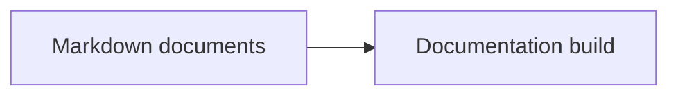
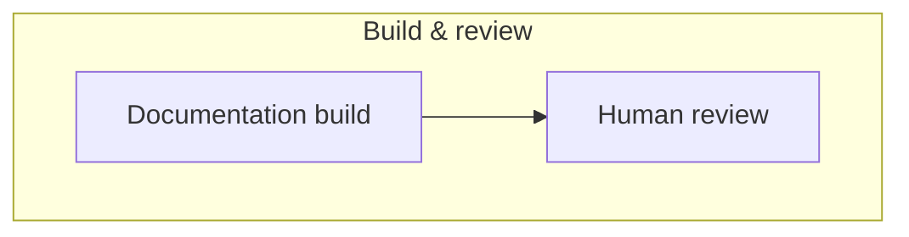

# DiagramFigure

Wrap Mermaid fences in a figure to share restrained captions, role colors and selective icons,
responsive keys, and an accessible enlargement dialog. Docusaurus still renders
the Mermaid source through its rendering hook; no separate Mermaid instance or
icon dependency is needed.

````mdx
import DiagramFigure from '@site/src/components/DiagramFigure';

<DiagramFigure {...{
  "number": 1,
  "title": "Documentation publishing",
  "legend": [
    {"role": "input", "label": "Source documents"},
    {"role": "process", "label": "Build and publication"}
  ]
}}>



</DiagramFigure>
````

Use a literal JSON spread, as shown, so the Markdown exporter can retain the
figure title and key without evaluating JavaScript. Number figures explicitly
within each page. Legend labels may be omitted to use the role's default label.

## Roles and icons

The single palette in `theme.cjs` supplies Mermaid `classDef` colors, legend
swatches, icons, default labels, and the Markdown exporter. Assign roles with
standard `class NodeA,NodeB role;` statements, one statement per line.

| Role | Default icon | Meaning |
| --- | --- | --- |
| `input` | File | Source documents and inputs |
| `process` | None | Processing and delivery |
| `storage` | Database | Persisted data, indexes, registries and logs |
| `infra` | Server | Hosting environments, infrastructure and configuration |
| `decision` | None | Decisions and approvals |
| `interaction` | User | Authoring, human review and user-facing interfaces |
| `generation` | Magic wand with sparkles | AI generation |

The renderer and key use the same muted palette and optional icons. Processing and
decisions rely on labels, colors and shapes; icons identify inputs, storage,
infrastructure, people and AI.

Classify the role depicted by the node: migration and merge operations are
`process`; a scenario override value is `input`; a portal or review site is
`interaction`; a staging environment is `infra`. Reserve `decision` for actual
choices and approval decisions, rather than human review or the merge that
follows approval. Stored content and the interface used to access it are
different roles.

The adapter inserts icons into quoted node labels, including cylinders,
diamonds, rounded nodes and Mermaid Markdown strings. Define nodes with quoted
labels, as above. A label starting with an explicit Font Awesome reference, such
as `fa:fa-globe Browser`, overrides its default icon. Include every used role in
the figure's key. Other Mermaid diagram types and diagrams outside a figure are
passed through unchanged.

## Container purposes

Give a Mermaid subgraph an explicit purpose with a `group-` class:



All `group-` classes use a neutral grey fill and a visible grey border. Child
nodes retain their individual role colors. Every node role has a matching
`group-` purpose for authoring, but containers do not introduce an additional
color classification or need legend entries.

## Multiple panels

A single figure can wrap several fences in a `<div className="diagram-columns">`.
Wrap each panel in `<div className="diagram-panel">` and give it a Markdown
level-four heading. Panels align at the top when the figure has at least 48rem
of space and stack below that width, including narrow desktop content areas.
One shared title, key and enlargement button covers the whole figure.

Single diagrams and stacked panels retain at least 90% of Mermaid's natural
text size. Desktop panels fit their columns. Wide diagrams scroll
inside their canvas or panel rather than forcing the page wider or shrinking
node text to fit a phone.

Enlargement moves the figure content into a fresh Mermaid render, reserving its
original space. Only one copy of the diagrams and heading IDs exists at a time.
The dialog fills the viewport, including its full dynamic height on mobile.
The native dialog supports Escape, focus containment and
returning focus to its opener. Its title and key remain available while enlarged. The expanded viewport supports
mouse-wheel zoom around its midpoint, plus/minus buttons with wheel hints, and
a percentage indicator (25–400%). Drag in any direction to pan; keyboard users
can focus the viewport and pan with arrow keys. The legend and controls stay
fixed while the diagram moves. Each opening resets to 100%.

Run `npm run test:diagram-figure`, `npm run typecheck`, and `npm run build` when
changing the component, palette or Mermaid adapter.

For rendered regression checks, start the dev server and use an existing
Playwright installation (no browser dependency is added to the site):

```sh
PLAYWRIGHT_MODULE=/absolute/path/to/playwright-core \
CHROMIUM_EXECUTABLE=/absolute/path/to/chromium \
DIAGRAM_SCREENSHOTS=/tmp/diagram-check \
node scripts/tests/diagram-figure.browser.cjs
```

Optional `DIAGRAM_BASE_URL` selects another server; `DIAGRAM_BROWSER_LIBRARY_PATH`
provides existing browser runtime libraries when required. Checks cover every
site diagram at desktop, tablet and phone widths, light/dark themes, actual SVG
colors/icons and readable text, RAG panel headings, fullscreen dimensions, and
closing the dialog with Escape or its Close button.

Adding a theme wrapper requires restarting an already running dev server;
reloading the configuration alone does not rebuild its theme aliases.
